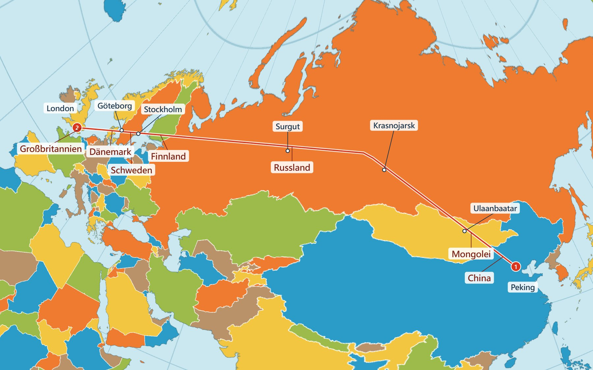

# tetra-unfold

[English](README.md) | [繁體中文](README.zh-TW.md) | [简体中文](README.zh-CN.md) | [日本語](README.ja.md) | [한국어](README.ko.md) | **Deutsch** | [Français](README.fr.md) | [Español](README.es.md) | [Русский](README.ru.md)

> Dies ist eine Übersetzung der englischen Fassung. Bei Abweichungen gilt die [englische Fassung](README.md).

**Von Peking nach London: Über welche Länder und an welchen Städten führt die Route vorbei?**



<sub>Die Karte zeigt die kürzeste Großkreisroute zwischen den beiden Orten, nicht den tatsächlichen Flugweg.</sub>

China → Mongolei → Russland → Finnland → Schweden → Dänemark → Vereinigtes Königreich, insgesamt 8.154 km. Die Route führt nahe an Ulaanbaatar, Krasnojarsk, Surgut, Stockholm und Göteborg vorbei. Der Knick in der Linie ist eine Faltkante der Karte, keine Kurve des Flugzeugs. [Diese Route öffnen](https://iantpe.github.io/tetra-unfold/?lang=de&trip=PEK,LHR&rt=0).

**Dienstreisen planen, Umsteigeverbindungen vergleichen oder sehen, wo ein Flug entlangführt: Dafür ist diese Weltkarte gedacht.** Prüfe zuerst auf der Karte, ob eine Route sinnvoll ist, und vergleiche dann die Preise. [Karte öffnen](https://iantpe.github.io/tetra-unfold/?lang=de); eine Installation ist nicht nötig.

Zum Beispiel sind es von Taipeh nach London direkt 9.783 km, [über Shanghai](https://iantpe.github.io/tetra-unfold/?lang=de&trip=TPE,PVG,LHR&rt=0) 9.918 km (nur 135 km mehr) und [über Doha](https://iantpe.github.io/tetra-unfold/?lang=de&trip=TPE,DOH,LHR&rt=0) 12.160 km (2.377 km mehr).

Für die Karte wird die gesamte Kugeloberfläche auf ein **regelmäßiges Tetraeder** abgewickelt und dann zu einem Rechteck ausgebreitet, mit dem sich die Ebene **nahtlos kacheln** lässt.

Die Demo verwendet eine Weltkarte und ist von der [AuthaGraph-Weltkarte](https://www.authagraph.com/) von Hajime Narukawa inspiriert. Sie ist keine Implementierung von AuthaGraph: Dessen Algorithmus ist patentiert und nicht veröffentlicht, daher verwendet dieses Projekt eine eigene Annäherung. Dieselbe Methode lässt sich auch auf **Bilder von 360°-Kameras** anwenden, sodass ein KI-Modell die gesamte Kugel in einem einzigen flachen Bild sieht.


## Demos

**Online ausprobieren: <https://iantpe.github.io/tetra-unfold/?lang=de>**

Die Karte gibt es auf 繁體中文, 简体中文, English, 日本語, 한국어, Deutsch, Français, Español und Русский. Die Sprache des Browsers wird automatisch gewählt; über das Menü im Bedienfeld lässt sie sich wechseln, oder man hängt `?lang=` an die Adresse an (`zh-Hant`, `zh-Hans`, `en`, `ja`, `ko`, `de`, `fr`, `es`, `ru`).

Reise, Entfernungsradius, Drehung und Einstellungen werden laufend in der Adresse gespeichert. Als Lesezeichen oder an andere geschickt, öffnet sich die Seite genau so, wie du sie verlassen hast. **Link zum Teilen kopieren** im Bedienfeld kopiert die Adresse. [Dieser Link](https://iantpe.github.io/tetra-unfold/?lang=de&trip=TPE,NRT,LHR,SIN&range=TPE,5000) öffnet zum Beispiel die Reise Taipeh → Tokio → London → Singapur mit einem 5.000-km-Radius um Taipeh. Auf keinem Server wird etwas gespeichert; alles steht in der Adresse.

Die Karte besteht aus einer einzigen HTML-Datei sowie `i18n.js` (Oberflächentexte), `tetra-map.js` (Projektion und Zeichnen), `trip-order.js` (Berechnung der kürzesten Reihenfolge), `airports.json` und `names/<Sprache>.json` (Flughafen- und Städtenamen). Es muss nichts installiert oder gebaut werden. Zum Laden von D3 und den Ländergrenzen ist eine Internetverbindung nötig.

| Datei | Inhalt |
|---|---|
| [`index.html`](index.html) · [öffnen](https://iantpe.github.io/tetra-unfold/?lang=de) | Tetraeder-Weltkarte. Eine Tetraederkante verläuft entlang 90° Ost senkrecht durch die Mitte der Karte, mit Ecken in der Mitte des oberen und des unteren Rands. Anfangs liegt der Nordpol auf der oberen Ecke; Ziehen nach oben und unten verschiebt den Globus entlang dieser Kante, bis der Südpol auf der unteren Ecke liegt (die Schaltflächen **Nordpol oben** und **Südpol unten** springen direkt zwischen beiden). Das Ziehen stoppt an diesen beiden Stellungen; ein Kontrollkästchen hebt die Begrenzung auf, sodass sich der Globus weiterdrehen lässt. In beiden Stellungen liegen die übrigen Ecken im Meer. Nahtloses Kacheln, Drehen des Globus durch Ziehen, abschaltbare Flächenkorrektur, Faltlinien des Tetraeders und Ländernamen beim Überfahren mit der Maus. |

Bedienung:

- Ziehen: Globus drehen (in `index.html` verschiebt Umschalt + Ziehen die Ansicht)
- Mausrad: zoomen (`index.html`)
- Tastatur (auf allen drei Seiten): Mit Tab die Karte auswählen, dann mit den Pfeiltasten den Globus drehen, mit Umschalt + Pfeiltasten verschieben und mit + / - zoomen. Im Modus **Verschieben** in `index.html` tauschen Pfeiltasten und Umschalt + Pfeiltasten die Rollen
- Mauszeiger darüber: Ländername und Koordinaten anzeigen
- Auf dem Smartphone (`index.html`): Mit einem Finger drehst du den Globus, mit zwei Fingern zoomst und verschiebst du. Tippen zeigt den Namen an. Um einen Flughafen hinzuzufügen, tippe ihn an und wähle **Zur Reise hinzufügen**. Einstellungen und Reise liegen in der Leiste unten am Bildschirm; zum Öffnen antippen oder nach oben wischen

### Eine Reise mit mehreren Stationen planen (`index.html`)

Die Karte eignet sich gut, um Flugrichtungen zu prüfen: Bei ausgeschalteter Flächenkorrektur (Standard) ist jede Dreiecksfläche eine gnomonische Projektion. Eine Großkreisroute ist daher innerhalb einer Fläche eine Gerade und knickt nur dort ab, wo sie eine Faltlinie überquert.

- Flughäfen fügt man hinzu, indem man auf die Punkte in der Karte klickt oder einen IATA-Code, eine Stadt, einen Flughafennamen oder ein Land in der gewählten Sprache oder auf Englisch eingibt (zum Beispiel `TPE`, `London`, `München`, `Londres`). Hat eine Stadt mehrere Flughäfen, steht der mit den meisten Passagieren vorn. Beim Hineinzoomen erscheinen auch mittelgroße Flughäfen.
- Jede Etappe wird als Großkreisroute gezeichnet, mit ihrer Entfernung und der Gesamtstrecke. Mit **Am Ende zum Start zurückkehren** wird eine Rundreise berechnet.
- **Beste Reihenfolge berechnen** behält den ersten Halt als Start, und sucht für die übrigen die Reihenfolge mit der kürzesten Gesamtstrecke. Eine Reise kann bis zu 30 Halte haben: Bis 16 Halte ist das Ergebnis wirklich die kürzeste Reihenfolge, darüber eine Näherung, die nicht unbedingt die kürzeste ist.
- Ist ein Teil der Route nicht zu sehen, dreht sich die Karte so, dass die Route möglichst zusammenhängt; Norden bleibt oben. Das geschieht nach dem Hinzufügen eines Halts, nach dem Berechnen der Reihenfolge und beim Öffnen eines Links ohne gespeicherte Drehung. **Route zentrieren** macht dasselbe jederzeit. Eine Reise um die ganze Welt lässt sich nicht ohne Schnitt zeigen: Ihr Start erscheint dann an beiden Kartenrändern.
- Entfernungen sind Großkreisentfernungen auf einer Kugel mit 6.371 km Radius. Tatsächliche Flugwege sind meist etwas länger.

#### Flugpreise mit einem KI-Browserassistenten vergleichen

Die Karte findet die Reihenfolge mit der kürzesten Strecke, aber nicht die günstigsten oder schnellsten Flüge. Diesen Teil kann ein KI-Assistent übernehmen, der Ihren Browser bedienen kann, etwa Claude in Chrome oder der Agent von ChatGPT: Er liest die Reihenfolge von der Karte ab, sucht jede Teilstrecke auf einer Flugsuchseite wie Google Flüge und vergleicht die Kombinationen. Zum Beispiel:

> Öffne https://iantpe.github.io/tetra-unfold/ und plane eine Reise von Taipeh (TPE) nach Tokio, Singapur und London und zurück nach Taipeh. Vergleiche die Reihenfolge der Karte mit den anderen Reihenfolgen. Suche dann auf Google Flüge einfache Economy-Flüge für den 1., 4., 7. und 10. Dezember und liste für jede Reihenfolge den Gesamtpreis und die gesamte Reisezeit auf.

Ein Test mit genau dieser Reise (Preise vom November 2026, ein Erwachsener, Economy, einfache Flüge inklusive Steuern, in Neuen Taiwan-Dollar):

| Reihenfolge (zurück nach Taipeh) | Großkreisstrecke | Gefundene Flüge | Gesamtpreis | Gesamte Reisezeit |
|---|---:|---|---:|---:|
| Tokio → Singapur → London | 28.206 km | Londoner Strecke über Shanghai | NT$49.198 | 47 h 30 min |
| Tokio → Singapur → London | 28.206 km | Londoner Strecke über Doha | NT$50.509 | 44 h 05 min |
| Tokio → London → Singapur (Reihenfolge der Karte) | 25.878 km | Über Shanghai und München | NT$50.779 | 45 h 50 min |

- **Die kürzeste Reihenfolge ist nicht immer die günstigste.** Die Reihenfolge der Karte sparte 2.328 km (8,3 %), doch an diesen Tagen kosteten ihre Flüge etwas mehr. Die Preise hängen vor allem davon ab, welche Fluggesellschaften eine Strecke bedienen.
- **Der Umsteigeort kann so viel ausmachen wie die Reihenfolge.** Umsteigen in Doha statt in Shanghai auf der Strecke Singapur–London kostete 1.311 NT$ mehr, sparte aber 3 h 25 min.
- **Nachtflüge verkürzen die Aufenthalte**, was die Karte nicht zeigen kann.

Schließen Sie also mit der Karte Reihenfolgen aus, die Umwege machen, und lassen Sie den Assistenten die Preise der wenigen verbleibenden Reihenfolgen vergleichen. Der Assistent sucht nur; buchen und bezahlen Sie selbst. Die Preise ändern sich ständig, und ein Gabelflug- oder Multi-City-Ticket kann günstiger sein als einzelne einfache Flüge. Lassen Sie auch das prüfen.

### Entfernungsradius (`index.html`)

Wähle einen Mittelpunkt (Flughafencode, Stadt oder den ersten Stopp der Reise) und einen Radius in Kilometern oder Flugstunden. Die Karte färbt alle Orte innerhalb dieser Großkreisentfernung ein und listet die Städte mit großen Flughäfen im Kreis auf, die nächsten zuerst. Beim Überfahren mit der Maus wird für jeden Punkt die Entfernung zum Mittelpunkt angezeigt.

Auf dem Globus ist der Bereich ein Kreis, auf dieser Karte aber nicht: Innerhalb einer Fläche ist er ein glattes Oval, und an den Faltlinien knickt er ab. Ein Kreis mit 5.000 km um Taipeh reicht zum Beispiel bis Delhi (4.373 km) und Darwin (4.298 km), endet aber knapp vor Mumbai (5.002 km). Flugstunden werden mit durchschnittlich 800 km/h umgerechnet und sind nur ein grober Richtwert.

### Flugwiedergabe (`launch.html`)

[`launch.html`](launch.html) · [online](https://iantpe.github.io/tetra-unfold/launch.html) spielt den 11. Starship-Testflug auf der Tetraederkarte ab und zeigt Zeit, Höhe, Geschwindigkeit, ein Höhendiagramm und dieselbe Route auf einer gewöhnlichen Karte. Die mittlere Kante bleibt senkrecht in der Bildschirmmitte, sodass Nord und Süd leicht zu erkennen sind. **Dies ist eine Rekonstruktion zur Veranschaulichung, keine gemessene Telemetrie.** Sie beruht auf dem Startplatz, dem Landepunkt, einem öffentlichen Zeitplan und der Erdrotation. Höhe und Geschwindigkeit in Aufstieg und Wiedereintritt sind angenommen. Die Seite spielt nur eine Datendatei ab und berechnet keine Flugbahnen.

Die Seite spielt auch einen **gemessenen** Langstreckenflug ab: [NASAs Global Hawk am 6.–7. September 2012](https://iantpe.github.io/tetra-unfold/launch.html?flight=global-hawk-hs3), von Dryden in Kalifornien nach Wallops in Virginia, um die Ostseite des Hurrikans Leslie (19,2 Stunden, 11.576 km). [`flights/global-hawk-hs3.json`](flights/global-hawk-hs3.json) enthält eine Zeile pro Minute aus NASAs Navigationsdateien. Lücken von 12 und 4 Minuten sind durch Geraden verbunden. Für diese Datei gelten NASAs Datenbedingungen, nicht die Lizenz dieses Repositorys. Quellenangabe: Sorenson, C. (2025). *Hurricane and Severe Storm Sentinel (HS3) Global Hawk Navigation* [Data set]. NASA GHRC DAAC. https://doi.org/10.5067/HS3/NAV/DATA201

**Für einen anderen Flug** lege eine Datendatei in `flights/` an ([`flights/starship-11.json`](flights/starship-11.json) dient als Vorlage) und trage sie in `FLIGHTS` in `launch.html` ein. `rows` enthält ein Array pro Spalte: `t` (Sekunden nach dem Start), `lat`, `lon` (Grad), `alt` (km), `speed` (km/h) und `dist` (Bodenstrecke in km). Werte zwischen den Zeilen interpoliert die Seite. Titel, Beschriftungen, Ereignisse, Quellen und Kartenrichtung stehen in derselben Datei.

**Für die Kartenrichtung einer neuen Route** ändere nur `view` in der Datendatei. Der Zoom wird automatisch berechnet.

1. Öffne die Seite, drücke **Whole route** (ganze Route) und ziehe die Karte, bis die Route gut aussieht.
2. Gib in der Browserkonsole `[state.yaw, state.pitch]` ein.
3. Trage die beiden Zahlen in `view` als `yaw` und `pitch` ein.

`yaw` ist der Längengrad auf der Mittellinie minus 90 (liegt das Ergebnis unter −180, addiere 360). `pitch` reicht von 0 bis 70,5; je weiter südlich die Route liegt, desto größer ist meist der Wert. Halte die Route von den farbigen Eckpunkten fern, sonst knickt sie zu einem spitzen V ab.

### Kurzwellen-Großkreiswege (`radio.html`)

[`radio.html`](radio.html) · [online](https://iantpe.github.io/tetra-unfold/radio.html) zeigt den kurzen und den langen Weg zwischen Taipeh und London als fast geraden Großkreis, dazu die Entfernung, die Antennenrichtung von beiden Enden und welcher Anteil jedes Wegs zu einer gewählten UTC-Zeit im Dunkeln liegt. Die Seite zeigt nur die Geometrie und sagt keine Ausbreitung voraus. Für andere Orte ändere `A`, `B` und `CIRCLE_VIEW` am Anfang der Datei; `CIRCLE_VIEW` funktioniert wie `view` in der Flugwiedergabe.

## Mit Claude Code, Codex oder Antigravity verwenden

Das Repository enthält zwei Skills für Coding-Agenten. Klone es, starte [Claude Code](https://code.claude.com/docs/en/skills) oder [Codex](https://learn.chatgpt.com/docs/build-skills) im Ordner oder öffne den Ordner in [Antigravity](https://antigravity.google/docs/skills) und formuliere deine Bitte einfach in eigenen Worten:

```
git clone https://github.com/ianTPE/tetra-unfold
cd tetra-unfold
claude    # oder: codex
```

| Skill | Beispiel | Voraussetzung |
|---|---|---|
| `plan-route` | Plane die kürzeste Reise von Taipeh nach Tokio, Singapur und London und gib mir den Kartenlink | Node.js |
| `plan-route` | Suche auf Google Flights echte Flüge und den Gesamtpreis für diese Reise, Abflug am 7. Dezember, 3 Tage pro Stopp | Node.js, ein Browser, den der Agent steuern kann |
| `unfold-360` | Falte photo.jpg auf | Python, `pip install numpy pillow` |

Die Skills werden nur geladen, wenn der Agent in diesem Repository arbeitet. Das Routenwerkzeug läuft auch ohne Agent: `node plan_route.js TPE Tokyo Singapore London`. Es liefert Großkreisentfernungen, keine Preise und keine Angaben zu verfügbaren Flügen. Echte Flüge und Preise sucht der Agent im Browser auf Google Flights, gebucht wird nichts.

## Funktionsweise

### Warum sich die Karte nahtlos kacheln lässt

Die Ebene wird mit einem Gitter aus gleichseitigen Dreiecken der Seitenlänge 1 überdeckt. Teilt man die Gitterpunkte `(i, j)` nach der Parität von `i` und `j` ein, ergeben sich genau 4 Klassen, eine für jede Ecke des Tetraeders, und jedes kleine Dreieck wird zu einer Fläche des Tetraeders.

An jeder Ecke eines regelmäßigen Tetraeders treffen drei Flächen zusammen, der Gesamtwinkel um eine Ecke beträgt also 3 × 60° = **180°**. Die ganze Ebene ist daher die Oberfläche des Tetraeders, wiederholt durch 180°-Drehungen um jeden Gitterpunkt. Das Rechteck `[0, 2] × [0, √3/2]` enthält genau eine vollständige Karte. Benachbarte Reihen sind um 180° gedreht, sodass sich Kopien der Karte in jede Richtung unendlich aneinanderfügen. `index.html` dreht dieses Gitter um 90°, damit eine Kante senkrecht steht: Die Karte ist dann das Rechteck `√3 × 1` mit je einer Ecke in der Mitte jeder Seite und keiner im Inneren, und auch das ist genau eine vollständige Karte.

### Von der Ebene zur Kugel

Jedes Pixel wird so berechnet:

1. Das kleine Dreieck finden, das das Pixel enthält, und seine baryzentrischen Koordinaten bestimmen.
2. Mit den baryzentrischen Koordinaten einen Punkt auf der passenden Fläche des Tetraeders wählen.
3. Diesen Punkt auf die Kugel bringen, in einem von zwei Modi:
   - **Unkorrigiert (gnomonisch)**: geradlinig vom Kugelmittelpunkt nach außen projizieren. Jede Fläche sieht aus wie das Bild einer extremen Weitwinkel-Lochkamera, und **Geraden bleiben gerade**.
   - **Flächenkorrigiert**: Entfernungen entlang jedes Strahls vom Flächenmittelpunkt neu verteilen, sodass Flächen auf der Karte ungefähr proportional zu Flächen auf der Kugel sind.
4. Mit der Rotationsmatrix Länge und Breite berechnen und die Farbe aus einer Textur in quadratischer Plattkarte holen.

Da jedes Pixel rückwärts nachgeschlagen wird, ist kein Polygon-Clipping nötig, und Kacheln und Drehen gibt es fast umsonst.

### Verzerrung an den Ecken ist unvermeidlich

Um eine Tetraederecke herum liegen nur 180°, um jeden Punkt einer Kugel aber 360°. Die Umgebung jeder der 4 Ecken muss daher um etwa das Doppelte gedehnt werden, gleich mit welcher Formel. AuthaGraph hat dieselbe Verzerrung und legt seine Ecken in die Ozeane.

## Anwendung: 360°-Kameras, KI-Erkennung und Fluglage von Drohnen

360°-Kameras geben meist Bilder in quadratischer Plattkarte aus (Panoramen im Format 2:1). Das ist dasselbe Format wie die hier verwendete Weltkartentextur, die Methode funktioniert also, indem man die Textur durch ein 360°-Foto ersetzt.

Im Vergleich mit gängigen Formaten:

- **Quadratische Plattkarte**: Objekte werden am linken und rechten Rand zerschnitten, und die Pole sind stark gedehnt.
- **Cubemap (6 Flächen)**: Jede Fläche sieht aus wie ein gewöhnliches Foto, aber es gibt viele Nähte, und Objekte über Nähte hinweg brauchen eine Sonderbehandlung.
- **Tetraeder-Abwicklung**: ein einziges rechteckiges Bild der ganzen Kugel ohne Schnitte, das sich direkt in gängige Bildmodelle einspeisen lässt. Der Nachteil ist die Verzerrung nahe den 4 Ecken.

### Horizont-Anordnung

[`unfold360.py`](unfold360.py) verwendet dasselbe `√3 × 1`-Netz wie `index.html` (eine Tetraederkante verläuft senkrecht durch die Mitte), so gedreht, dass bei waagrechter Kamera gilt:

- **Die waagrechte Mittellinie ist der Horizont.** Die obere Bildhälfte ist vollständig Himmel, die untere vollständig Boden, jede genau die Hälfte der Kugel.
- Die Bildmitte blickt geradeaus. Direkt hinten liegt in den vier Ecken, und der Horizont setzt sich entlang des linken und rechten Rands fort.
- Der Zenit liegt bei 1/4 und 3/4 des oberen Rands, der Nadir an denselben Stellen des unteren Rands.
- Die 4 Tetraederecken liegen in der Mitte des oberen und unteren Rands (54,7° über und unter dem Horizont, geradeaus) und in der Mitte des linken und rechten Rands (auf dem Horizont, 125,3° zu jeder Seite).

Da sich die Verzerrung an den Ecken nicht vermeiden lässt, kann das Bild **in zwei Ausrichtungen abgewickelt** werden; jede Richtung wird aus dem Bild gelesen, in dem sie weiter von einer Ecke entfernt ist. **B ist A, um 180° um die senkrechte Achse gedreht.** Die 4 Ecken von A liegen symmetrisch über und unter dem Horizont, daher landen die Ecken von B nach der Drehung genau gegenüber denen von A, in der Mitte jeder Fläche von A, wo A am wenigsten verzerrt ist. In beiden Bildern ist der Himmel oben. Dann ist jede Richtung in einem der beiden Bilder mindestens 35,3° von einer Ecke entfernt, auch jeder Punkt auf dem Horizont:

| B gedreht um | Ungünstigste Richtung, Abstand zu einer Ecke |
|---|---|
| 180° | 35,3° |
| 150° | 20,3° |
| 90° | 9,8° |
| 0° | 0° (beide Bilder gleich) |

```
pip install numpy pillow
python unfold360.py photo.jpg out/
```

### Fluglage von Drohnen: Himmel und Boden unterscheiden

Eine Drohne weiß über ihre IMU (Gyroskop und Beschleunigungsmesser), wo oben ist. Der Beschleunigungsmesser misst aber die Schwerkraft **plus die eigene Beschleunigung der Drohne**. Bei Böen, Zusammenstößen, Überschlägen oder harten Manövern ist das „Unten“, das er meldet, daher falsch, und das Gyroskop allein driftet mit der Zeit. Auch das Magnetometer lässt sich leicht durch elektromagnetische Störungen beeinflussen.

Die Grenze zwischen Himmel und Boden in einem 360°-Bild ist eine **unabhängige Referenz**: Sie wird weder von elektromagnetischen Störungen noch von der Beschleunigung der Drohne beeinflusst. Die Idee ist, sie **mit der IMU zu kombinieren**: normalerweise die IMU verwenden und, wenn die Drohne gestört wird und dem Beschleunigungsmesser nicht zu trauen ist, die Lage mit der im Bild erkannten Richtung nach oben korrigieren. Das ist vor allem für Drohnen wichtig, die auch unter Störungen weiterfliegen müssen.

Die Horizont-Anordnung eignet sich dafür:

- Ein nahtloses Bild deckt die ganze Kugel ab, sodass der Himmel nie über Bildränder hinweg zerteilt wird, wie auch immer die Drohne gedreht ist.
- Bei waagrechter Drohne ist die obere Hälfte Himmel und die untere Boden, was die Beschriftung zum Trainieren eines Segmentierungsmodells für Himmel und Boden einfach macht.
- Im flächenkorrigierten Modus deckt jedes Pixel denselben Raumwinkel ab, Pixelrichtungen lassen sich also direkt mitteln.

#### Test

[`drone_attitude.py`](drone_attitude.py) simuliert pro Foto eine Drohne in 300 zufälligen Lagen, auch kopfüber. Für jede Lage wird das 360°-Bild im eigenen Koordinatensystem der Drohne abgewickelt (128 × 74 Pixel, flächenkorrigiert) und „oben“ mit einer bewusst einfachen Regel geschätzt:

- Helle, bläuliche Pixel sind Himmel. Der Schwellenwert wird für jedes Bild automatisch gewählt (Otsu-Verfahren).
- Schwarze Bereiche „ohne Daten“ werden ignoriert.
- Die Richtung nach oben ist die mittlere Richtung der Himmelspixel minus die der Bodenpixel.

Getestet wurde mit sechs 360°-Luftpanoramen von Wikimedia Commons (von Gunther Tschuch, CC BY-SA 4.0):

| Gelände | Kopfüber | Fehler (Median) | Fehler (90 %) | Größter | Schätzschritt (ohne Abwicklung) |
|---|---|---|---|---|---|
| Ackerland (Sebnitz) | 0 / 300 | 5,4° | 8,5° | 10,7° | 0,9 ms |
| Stadt (Bad Karlshafen) | 0 / 300 | 6,6° | 10,7° | 13,9° | 0,9 ms |
| Stadt im Flusstal (Hirschhorn) | 0 / 300 | 7,6° | 11,4° | 16,7° | 0,9 ms |
| Inselküste (Skye) | 0 / 300 | 11,1° | 16,1° | 20,5° | 0,9 ms |
| See (Loch Tay) | 0 / 300 | 11,5° | 16,2° | 18,4° | 0,9 ms |
| Küste und Berge (Mull) | 0 / 300 | 13,6° | 18,1° | 22,3° | 0,9 ms |

| Waagrecht | Um 70° geneigt | Mit der Schätzung wieder waagrecht gedreht |
|---|---|---|
|  |  |  |

Ergebnisse:

- **In 1.800 zufälligen Lagen wurden Himmel und Boden nie vertauscht.** Die Richtung lag im Median 5–14° daneben, höchstens 22°. In Python auf einer Desktop-CPU dauerte der Schätzschritt etwa 1 ms; das Abwickeln eines Bildes mit 2048 × 1024 Pixeln kostet weitere etwa 12 ms, insgesamt also etwa 13 ms pro Bild.
- Wasser, das den Himmel spiegelt (Seen, Küsten), verursacht die größten Fehler.
- **Die Kamera muss den Himmel sehen können.** Diese Panoramen sind oberhalb von etwa 25° Höhe schwarz, weil die Kamera unter der Drohne hängt. Bevor die schwarzen Bereiche ausgeschlossen wurden, kamen die meisten Lagen kopfüber heraus. Eine Drohne, die das nutzt, braucht Kameras, die auch die obere Halbkugel abdecken, zum Beispiel eine 360°-Kamera mit Objektiven über und unter dem Rumpf.
- Vom Boden aus (1,5 m) aufgenommene Panoramen sind für eine fliegende Drohne nicht repräsentativ: Bäume und Gebäude verdecken einen großen Teil des Himmels.

Einschränkungen:

- Der Überschlag wird durch Drehen eines unbewegten Panoramas simuliert. Bewegungsunschärfe, plötzliche Belichtungswechsel, Propeller im Bild und Gegenlicht wurden nicht getestet.
- Die Helligkeitsregel versagt nachts, über Schnee und über Wolken. Dafür wäre ein trainiertes Segmentierungsmodell für Himmel und Boden nötig, das auch den Fehler von 5–14° verringern sollte.
- Die Kombination der Schätzung mit der IMU ist nicht implementiert.

## Numerische Prüfungen

Der Projektionscode wurde mit Node.js geprüft:

- Der Kachelfehler nach Verschiebung und 180°-Drehung beträgt etwa 10⁻¹⁵ (die Ränder passen exakt), und die Karte ist nicht gespiegelt.
- Der Hin-und-zurück-Fehler zwischen Karten- und Kugelkoordinaten liegt in beiden Modi unter 10⁻¹².
- Flächenverzerrung (Kartenfläche ÷ wahre Fläche):

| Modus | Bereich |
|---|---|
| Unkorrigiert | 0,13× – 3,3× |
| Flächenkorrigiert | 0,55× – 1,4× |

- Formverzerrung (Verhältnis von größter zu kleinster Dehnung) im unkorrigierten Modus: etwa 2,4× innerhalb von 10° um eine Ecke und höchstens 1,5× jenseits von 35°.

## Verwandte Projektionen

Den Globus auf ein Tetraeder abzuwickeln ist nicht neu. Die nächsten Vorläufer:

- **[Lees winkeltreue Tetraederprojektion](https://en.wikipedia.org/wiki/Lee_conformal_world_in_a_tetrahedron)** (L. P. Lee, 1965). Sie bildet den Globus ebenfalls auf ein regelmäßiges Tetraeder ab und kachelt die Ebene; ihre Kachel lässt sich zum selben `√3 × 1`-Rechteck umordnen. Das Original ist auf den Südpol zentriert, der auf einer Ecke liegt. Sie ist winkeltreu (lokale Formen stimmen), daher sind Großkreise gekrümmt. In D3 gibt es sie als [`d3.geoTetrahedralLee`](https://unpkg.com/browse/d3-geo-polygon@1.9.0/README.md), meist als Dreieck mit dem Pol in der Mitte gezeichnet.
- **[Doug McIlroys Tetraeder-Kartengrußkarte](https://cs.dartmouth.edu/~doug/cards/page1983.pdf)** (1983) verwendet Lees Projektion mit den Polen in der Mitte zweier gegenüberliegender Kanten und allen vier Ecken in den Ozeanen.
- **[AuthaGraph](https://en.wikipedia.org/wiki/AuthaGraph_projection)** (Hajime Narukawa) ist eine rechteckige, nahtlos kachelnde Tetraederkarte mit den Ecken in den Ozeanen. Ihr Algorithmus ist patentiert und nicht veröffentlicht.

Was dieses Projekt anders macht:

- Eine Kante verläuft senkrecht durch die Kartenmitte, und Ziehen verschiebt den Globus entlang dieser Kante zwischen Nordpol auf der oberen Ecke und Südpol auf der unteren.
- Jede Fläche ist eine gnomonische Projektion, Großkreis-Flugrouten sind innerhalb einer Fläche also gerade.
- Auf der Karte ist ein Reiseplaner eingebaut: Flughafensuche in neun Sprachen, Routen, Entfernungen und die kürzeste Besuchsreihenfolge.

## Verwandte Werkzeuge für die Reiseplanung

Auch andere Webwerkzeuge zeichnen Flugrouten mit mehreren Stationen und addieren Großkreisentfernungen:

| | Was man sieht | Routen | Geeignet für |
|---|---|---|---|
| [Great Circle Map](https://www.greatcirclemap.com/) | Ein drehbarer 3D-Globus (auch eine Mercator-Karte ist verfügbar); der Globus zeigt immer nur die halbe Erde | Korrekte Großkreisbögen; Entfernungen auf dem Ellipsoid | Eine oder wenige Etappen |
| [RapidToolset Multi-City Flight Planner](https://rapidtoolset.com/en/tool/multi-city-flight-planner) | Die ganze Welt auf einer herkömmlichen flachen Karte | Bögen zwischen den Stationen; Routen in hohen Breiten sind gedehnt, ihre wahre Richtung ist schwer einzuschätzen | Entfernungen addieren |
| Diese Karte | Die ganze Welt auf einer flachen, nahtlos kachelnden Karte | Gerade innerhalb jeder Fläche, Knicke nur an Faltlinien | Die **Reihenfolge** einer komplexen Reise durch mehrere Länder planen |

Ein Globus zeigt Richtungen korrekt, aber nie die ganze Reise auf einmal; eine herkömmliche Karte zeigt die ganze Reise, aber mit irreführenden Richtungen. Diese Karte zeigt die ganze Reise mit nahezu wahren Richtungen und kann die kürzeste Besuchsreihenfolge finden.

Die Entfernungen werden hier auf einer Kugel (Radius 6.371 km) berechnet. Sie weichen von Entfernungen auf dem Ellipsoid, wie bei Great Circle Map, um weniger als 0,4 % ab (zum Beispiel Taipeh–London: 9.783 km gegenüber 9.802 km). Das ist weit weniger als der Unterschied zwischen verschiedenen Reihenfolgen und ändert nicht, welche Reihenfolge die kürzeste ist.

## Quellen

- [D3.js](https://d3js.org/) 7.9.0: quadratische Plattkarte und Darstellung der Grenzen
- [TopoJSON](https://github.com/topojson/topojson) 3.0.2
- [world-atlas](https://github.com/topojson/world-atlas) 2.0.2: Ländergrenzen aus [Natural Earth](https://www.naturalearthdata.com/) (1:50m)
- [OurAirports](https://ourairports.com/data/): Flughafenliste (`airports.json`, Flughäfen mit Linienverkehr und IATA-Code), gemeinfrei
- [Wikidata](https://www.wikidata.org/): Flughafen- und Städtenamen auf Chinesisch, Japanisch, Koreanisch, Deutsch, Französisch, Spanisch und Russisch sowie Passagierzahlen zum Sortieren der Suchergebnisse, CC0. Chinesische Namen wurden mit [OpenCC](https://github.com/BYVoid/OpenCC) in traditionelle (Taiwaner Gebrauch) oder vereinfachte Schrift umgewandelt. Ländernamen stammen aus den eingebauten Übersetzungen des Browsers (`Intl.DisplayNames`)
- [Wikimedia Commons](https://commons.wikimedia.org/): 360°-Luftpanoramen von Gunther Tschuch (PaulT), CC BY-SA 4.0, für den Drohnentest: [Sebnitz Ottendorf](https://commons.wikimedia.org/wiki/File:Sebnitz_Ottendorf_Aerial_Pan360.jpg), [Kassel Bad Karlshafen](https://commons.wikimedia.org/wiki/File:Kassel_Bad_Karlshafen_Aerial_Pan360.jpg), [Hirschhorn (Neckar)](https://commons.wikimedia.org/wiki/File:Hirschhorn_(Neckar)_Aerial_Pan360.jpg), [Skye Dun Beag](https://commons.wikimedia.org/wiki/File:Skye_Dun_Beag_Aerial_Pan360.jpg), [Perth and Kinross Loch Tay](https://commons.wikimedia.org/wiki/File:Perth_and_Kinross_Loch_Tay_Aerial_Pan360.jpg), [Mull Lochbuie](https://commons.wikimedia.org/wiki/File:Mull_Lochbuie_Aerial_Pan360.jpg). `examples/aerial_*.jpg` sind Bearbeitungen des Panoramas Sebnitz Ottendorf und stehen unter CC BY-SA 4.0
- AuthaGraph ist ein Werk und eingetragenes Markenzeichen von Hajime Narukawa. Dieses Projekt steht in keiner Verbindung dazu.

## Lizenz

[PolyForm Noncommercial 1.0.0](LICENSE). Private Nutzung, Studium, Forschung, Hobbyprojekte sowie die Nutzung durch Schulen, gemeinnützige Organisationen, öffentliche Forschungseinrichtungen und Behörden sind kostenlos.

**Für kommerzielle Nutzung ist eine gesonderte, kostenpflichtige Lizenz nötig.** Kontakt: ertiach@gmail.com.

- Die Lizenz gilt für den Code in diesem Repository. Die oben genannten Bibliotheken und Daten (D3, TopoJSON, world-atlas / Natural Earth, OurAirports, Wikidata) behalten ihre eigenen Lizenzen. `examples/aerial_*.jpg` stehen unter CC BY-SA 4.0 (siehe Quellen).
- Maßgeblich ist der englische Wortlaut in der Datei LICENSE; diese Beschreibung dient nur zur Information.
