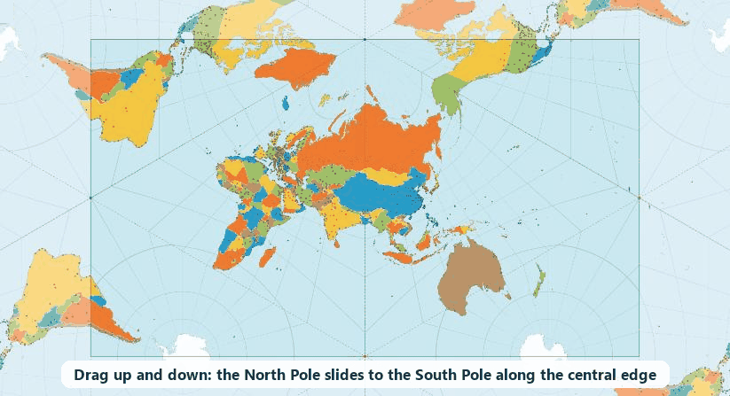
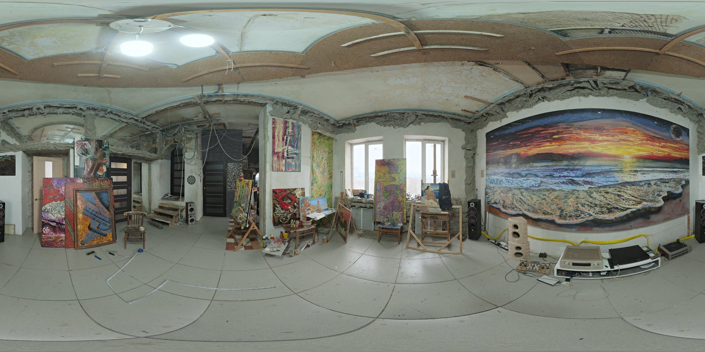
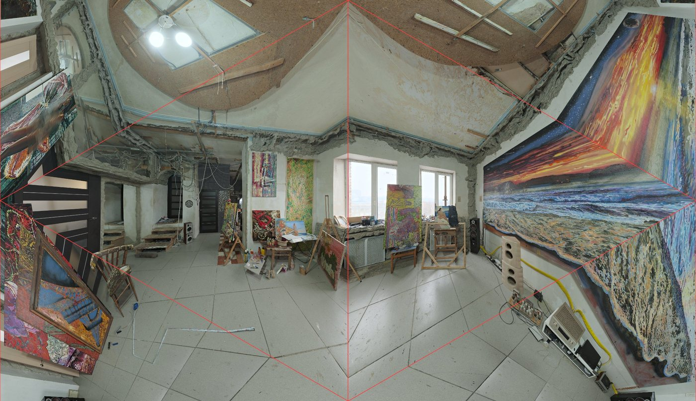
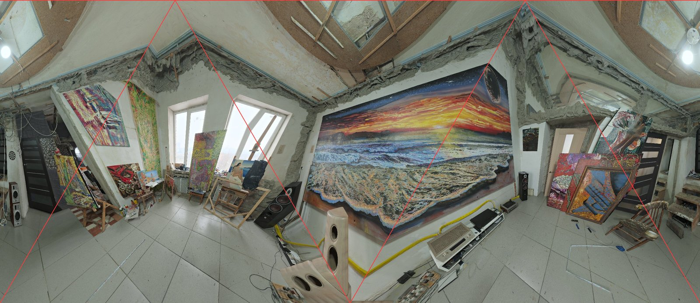
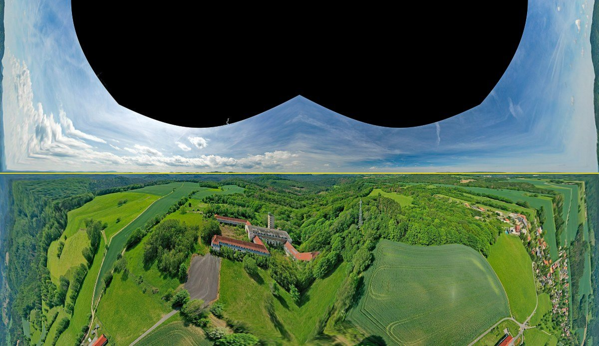
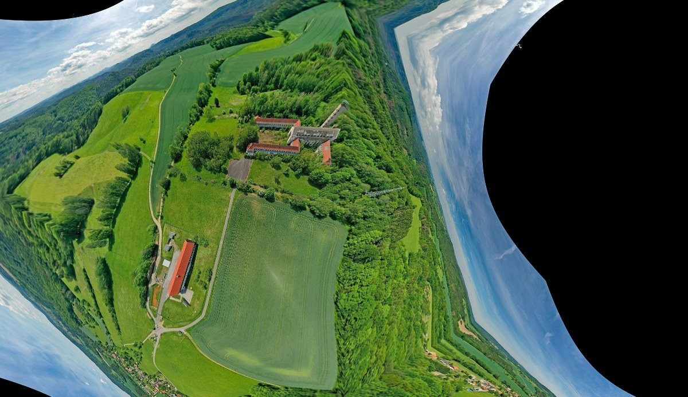
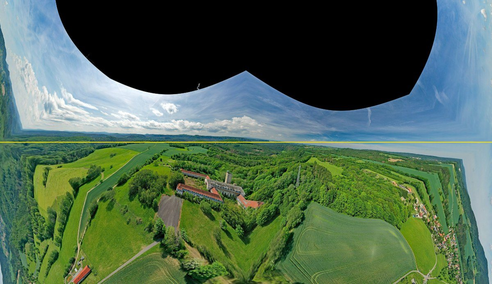

# tetra-unfold

[English](README.md) | [繁體中文](README.zh-TW.md) | [简体中文](README.zh-CN.md) | [日本語](README.ja.md) | [한국어](README.ko.md) | [Deutsch](README.de.md) | **Français** | [Español](README.es.md) | [Русский](README.ru.md)

> Ce document est une traduction de la version anglaise. En cas de différence, la [version anglaise](README.md) fait foi.

Déplier toute la sphère sur un **tétraèdre régulier**, puis l’aplatir en un rectangle qui **pave le plan sans raccord**.

La démonstration utilise une carte du monde et s’inspire de la [carte du monde AuthaGraph](https://www.authagraph.com/) de Hajime Narukawa. Ce n’est pas une implémentation d’AuthaGraph : son algorithme est breveté et non publié, ce projet utilise donc sa propre approximation. La même méthode s’applique aussi aux **images de caméras 360°**, pour qu’un modèle d’IA voie toute la sphère dans une seule image plane.



## Démonstrations

**Essayer en ligne : <https://iantpe.github.io/tetra-unfold/?lang=fr>**

La carte est disponible en 繁體中文, 简体中文, English, 日本語, 한국어, Deutsch, Français, Español et Русский. Elle choisit automatiquement la langue du navigateur ; on peut en changer avec le menu du panneau, ou ajouter `?lang=` à l’adresse (`zh-Hant`, `zh-Hans`, `en`, `ja`, `ko`, `de`, `fr`, `es`, `ru`).

La carte se compose d’un seul fichier HTML, de `i18n.js` (textes de l’interface), de `airports.json` et de `names/<langue>.json` (noms des aéroports et des villes). Rien à installer ni à compiler. Une connexion Internet est nécessaire pour charger D3 et les données des pays.

| Fichier | Contenu |
|---|---|
| [`index.html`](index.html) · [ouvrir](https://iantpe.github.io/tetra-unfold/?lang=fr) | Carte du monde tétraédrique. Une arête du tétraèdre forme l’axe vertical central de la carte le long du méridien 90° E, avec des sommets au milieu des bords supérieur et inférieur. Au départ, le pôle Nord est sur le sommet du haut ; glisser vers le haut ou le bas fait coulisser le globe le long de cette arête jusqu’à ce que le pôle Sud soit sur le sommet du bas (les boutons **Pôle Nord en haut** et **Pôle Sud en bas** passent directement de l’un à l’autre). Le glissement s’arrête à ces deux positions ; une case à cocher supprime la limite pour continuer à tourner le globe. Dans les deux positions, les autres sommets restent dans les océans. Pavage sans raccord, rotation du globe par glissement, correction des surfaces au choix, plis du tétraèdre et nom des pays au survol. |

Commandes :

- Glisser : faire tourner le globe (dans `index.html`, Maj + glisser déplace la vue)
- Molette : zoom (`index.html`)
- Survol : afficher le nom du pays et les coordonnées

### Planifier un voyage à plusieurs étapes (`index.html`)

La carte est pratique pour vérifier les directions de vol : quand la correction des surfaces est désactivée (par défaut), chaque face triangulaire est une projection gnomonique, si bien qu’une route orthodromique est droite à l’intérieur d’une face et ne se coude qu’en franchissant un pli.

- On ajoute des aéroports en cliquant sur les points de la carte, ou en tapant un code IATA, une ville, un nom d’aéroport ou un pays, dans la langue choisie ou en anglais (par exemple `TPE`, `London`, `Londres`, `ロンドン`). Quand une ville a plusieurs aéroports, le plus fréquenté apparaît en premier. En zoomant, on voit aussi les aéroports de taille moyenne.
- Chaque étape est tracée comme une route orthodromique, avec sa distance et le total du voyage. Cochez **Revenir au point de départ** pour un aller-retour.
- **Calculer le meilleur ordre** garde la première étape comme départ, essaie tous les ordres des autres (jusqu’à 10 étapes) et choisit celui dont la distance totale est la plus courte.
- Les distances sont orthodromiques, sur une sphère de 6 371 km de rayon. Les trajets réels sont en général un peu plus longs.

## Fonctionnement

### Pourquoi la carte pave le plan sans raccord

Le plan est recouvert d’un réseau de triangles équilatéraux de côté 1. En classant les points du réseau `(i, j)` selon la parité de `i` et de `j`, on obtient exactement 4 classes, une par sommet du tétraèdre, et chaque petit triangle devient une face du tétraèdre.

Trois faces se rejoignent à chaque sommet d’un tétraèdre régulier, l’angle total autour d’un sommet vaut donc 3 × 60° = **180°**. Le plan entier est ainsi la surface du tétraèdre répétée par des rotations de 180° autour de chaque point du réseau. Le rectangle `[0, 2] × [0, √3/2]` contient exactement une carte complète. Les rangées voisines sont tournées de 180°, de sorte que les copies de la carte s’assemblent à l’infini dans toutes les directions. `index.html` tourne ce réseau de 90° pour qu’une arête soit verticale : sa carte est le rectangle `√3 × 1`, avec un sommet au milieu de chaque côté et aucun à l’intérieur, et c’est là aussi exactement une carte complète.

### Du plan à la sphère

Chaque pixel est calculé ainsi :

1. Trouver le petit triangle qui contient le pixel et calculer ses coordonnées barycentriques.
2. Avec ces coordonnées, prendre un point sur la face correspondante du tétraèdre.
3. Porter ce point sur la sphère, selon l’un de deux modes :
   - **Sans correction (gnomonique)** : projeter en ligne droite depuis le centre de la sphère. Chaque face ressemble à l’image d’un sténopé à très grand angle, et **les droites restent droites**.
   - **Avec correction des surfaces** : redistribuer les distances le long de chaque rayon issu du centre de la face, pour que les aires sur la carte soient à peu près proportionnelles aux aires sur la sphère.
4. Appliquer la matrice de rotation pour obtenir la longitude et la latitude, puis lire la couleur dans une texture équirectangulaire.

Comme chaque pixel est calculé à rebours, il n’y a aucun découpage de polygones à gérer, et le pavage comme la rotation sont presque gratuits.

### La distorsion aux sommets est inévitable

Autour d’un sommet du tétraèdre il n’y a que 180°, alors qu’autour de tout point d’une sphère il y en a 360°. Le voisinage de chacun des 4 sommets doit donc être étiré d’environ 2 fois, quelle que soit la formule. AuthaGraph présente la même distorsion et place ses sommets dans les océans.

## Dépliage dans deux orientations

Puisque la distorsion aux sommets ne peut pas être supprimée, on déplie la sphère **deux fois, dans deux orientations**, pour que les sommets des deux cartes tombent à des endroits différents :

- **Orientation A** : les 4 sommets sont dans le Pacifique, l’Atlantique Nord, l’Atlantique Sud et l’océan Indien.
- **Orientation B** : le globe est tourné de 180° supplémentaires autour de son axe avant le dépliage.

Les 4 sommets de A sont symétriques par rapport à l’équateur. Après une rotation de 180°, les sommets de B tombent exactement à l’opposé de ceux de A, au centre de chaque face de A, là où A est le moins déformée. Le nord pointe dans le même sens sur les deux cartes, aucune n’est donc à l’envers.

Pour chaque lieu, on utilise la carte où il est le plus loin d’un sommet. Le tableau indique à quelle distance d’un sommet se trouve le lieu le plus défavorisé de la Terre, selon l’angle de rotation de B :

| Rotation de B | Lieu le plus défavorisé, distance à un sommet |
|---|---|
| 180° | 35,2° |
| 150° | 20,3° |
| 90° | 9,9° |
| 0° | 0° (cartes identiques, aucun intérêt) |

## Application : caméras 360°, reconnaissance par IA et attitude des drones

Les caméras 360° exportent généralement des images équirectangulaires (panoramas 2:1). C’est le même format que la texture de la carte du monde utilisée ici ; la méthode fonctionne donc en remplaçant la texture par une photo 360°.

Comparaison avec les formats courants :

- **Équirectangulaire** : les objets sont coupés aux bords gauche et droit, et les pôles sont fortement étirés.
- **Cubemap (6 faces)** : chaque face ressemble à une photo ordinaire, mais il y a beaucoup de coutures, et les objets à cheval sur une couture demandent un traitement particulier.
- **Dépliage tétraédrique** : une seule image rectangulaire de toute la sphère, sans coupure, utilisable directement par les modèles d’images courants. L’inconvénient est la distorsion près des 4 sommets.

### Disposition « horizon »

[`unfold360.py`](unfold360.py) utilise le même patron `√3 × 1` que `index.html` (une arête du tétraèdre traverse le centre verticalement), orienté de sorte que, caméra à l’horizontale :

- **La ligne médiane horizontale est l’horizon.** La moitié supérieure de l’image est entièrement du ciel et la moitié inférieure entièrement du sol, chacune exactement la moitié de la sphère.
- Le centre de l’image regarde droit devant. Droit derrière se trouve aux quatre coins, et l’horizon se prolonge le long des bords gauche et droit.
- Le zénith est au 1/4 et aux 3/4 du bord supérieur, et le nadir aux mêmes endroits du bord inférieur.
- Les 4 sommets du tétraèdre sont au milieu des bords supérieur et inférieur (54,7° au-dessus et au-dessous de l’horizon, droit devant) et au milieu des bords gauche et droit (sur l’horizon, à 125,3° de chaque côté).

Pour le dépliage dans deux orientations, **B est A tourné de 180°** autour de l’axe vertical. Toute direction est alors à au moins 35,3° d’un sommet dans l’une des deux images, y compris chaque point de l’horizon :

| Rotation de B | Direction la plus défavorisée, distance à un sommet |
|---|---|
| 180° | 35,3° |
| 150° | 20,3° |
| 90° | 9,8° |
| 0° | 0° (images identiques) |

```
pip install numpy pillow
python unfold360.py photo.jpg out/
```

### Test avec une photo d’intérieur

Testé avec le panorama [Art Studio](https://polyhaven.com/a/art_studio) de Poly Haven (les lignes rouges sont les plis du tétraèdre) :

| Image équirectangulaire d’origine |
|---|
|  |

| Orientation A | Orientation B (tournée de 180°) |
|---|---|
|  |  |

Observations :

- Toute la pièce tient dans une seule image, sans coupure. Le plafond occupe la moitié supérieure et le sol la moitié inférieure ; l’horizon (hauteur des yeux) suit la ligne médiane.
- Chaque face triangulaire est une vue en perspective distincte, si bien que les droites comme les angles des murs se coudent en franchissant un pli.
- Dans l’orientation A, la grande fresque se trouve près du sommet du bord droit et elle est étirée. L’orientation B la montre intacte et droite à gauche : c’est tout l’intérêt d’utiliser l’image où un objet est le plus loin d’un sommet.
- La gauche et la droite correspondent à la photo d’origine ; l’image n’est pas inversée.

Chaîne suggérée pour la reconnaissance d’objets : passer A et B au modèle, reconvertir chaque détection en coordonnées sphériques et garder le résultat de l’image où l’objet est le plus loin d’un sommet. La reconversion n’est pas encore implémentée, et la détection d’objets n’a pas encore été évaluée avec cette disposition. (Un test YOLO rapide sur trois panoramas d’intérieur, avec une disposition antérieure, n’a montré aucun avantage par rapport à la simple image équirectangulaire : les objets d’intérieur sont proches de l’horizon, où l’image équirectangulaire est très peu déformée.)

### Attitude des drones : distinguer le ciel du sol

Un drone sait où est le haut grâce à sa centrale inertielle (IMU : gyroscope et accéléromètre). Mais l’accéléromètre mesure la gravité **plus l’accélération propre du drone** : lors de rafales, de collisions, de culbutes ou de manœuvres brusques, le « bas » qu’il indique est faux, et le gyroscope seul dérive avec le temps. Le magnétomètre est lui aussi facilement perturbé par les interférences électromagnétiques.

La limite entre ciel et sol dans une image 360° est une **référence indépendante** : elle n’est affectée ni par les interférences électromagnétiques ni par l’accélération du drone. L’idée est de la **combiner avec l’IMU** : utiliser l’IMU en temps normal et, quand le drone est perturbé et que l’accéléromètre n’est plus fiable, corriger l’attitude avec la direction du haut vue dans l’image. C’est surtout important pour les drones qui doivent continuer à voler sous brouillage, comme les drones militaires.

La disposition « horizon » s’y prête bien :

- Une seule image sans raccord couvre toute la sphère : le ciel n’est jamais coupé par les bords de l’image, quelle que soit l’orientation du drone.
- Quand le drone est à l’horizontale, la moitié supérieure est le ciel et la moitié inférieure le sol, ce qui simplifie l’annotation pour entraîner un modèle de segmentation ciel/sol.
- En mode avec correction des surfaces, chaque pixel couvre le même angle solide : on peut donc moyenner directement les directions des pixels.

#### Test

[`drone_attitude.py`](drone_attitude.py) simule un drone dans 300 attitudes aléatoires par photo, y compris à l’envers. Pour chacune, il déplie l’image 360° dans le repère propre du drone (128 × 74 pixels, avec correction des surfaces) et estime le « haut » avec une règle volontairement simple :

- Les pixels clairs et bleutés sont du ciel. Le seuil est choisi automatiquement pour chaque image (méthode d’Otsu).
- Les zones noires « sans données » sont ignorées.
- La direction du haut est la direction moyenne des pixels de ciel moins celle des pixels de sol.

Le test a porté sur six panoramas aériens 360° de Wikimedia Commons (de Gunther Tschuch, CC BY-SA 4.0) :

| Terrain | À l’envers | Erreur (médiane) | Erreur (90 %) | Pire | Temps par estimation |
|---|---|---|---|---|---|
| Terres agricoles (Sebnitz) | 0 / 300 | 5,4° | 8,5° | 10,7° | 0,9 ms |
| Ville (Bad Karlshafen) | 0 / 300 | 6,6° | 10,7° | 13,9° | 0,9 ms |
| Ville de vallée fluviale (Hirschhorn) | 0 / 300 | 7,6° | 11,4° | 16,7° | 0,9 ms |
| Côte d’île (Skye) | 0 / 300 | 11,1° | 16,1° | 20,5° | 0,9 ms |
| Lac (Loch Tay) | 0 / 300 | 11,5° | 16,2° | 18,4° | 0,9 ms |
| Côte et montagnes (Mull) | 0 / 300 | 13,6° | 18,1° | 22,3° | 0,9 ms |

| À l’horizontale | Incliné de 70° | Remis à l’horizontale grâce à l’estimation |
|---|---|---|
|  |  |  |

Constats :

- **Sur 1 800 attitudes aléatoires, le ciel et le sol n’ont jamais été inversés.** La direction était fausse de 5 à 14° (médiane), 22° au plus, et chaque estimation prenait moins de 1 ms en Python sur un processeur d’ordinateur de bureau.
- L’eau qui reflète le ciel (lacs, côtes) produit les plus grandes erreurs.
- **La caméra doit pouvoir voir le ciel.** Ces panoramas sont noirs au-dessus d’environ 25° d’élévation, car la caméra est suspendue sous le drone. Avant d’exclure les zones noires, la plupart des attitudes étaient estimées à l’envers. Un drone qui utilise cette méthode a aussi besoin de caméras couvrant l’hémisphère supérieur, par exemple une caméra 360° avec des objectifs au-dessus et au-dessous du fuselage.
- Les panoramas pris depuis le sol (1,5 m) ne sont pas représentatifs d’un drone en vol : les arbres et les bâtiments cachent une grande partie du ciel.

Limites :

- Les culbutes sont simulées en faisant tourner un panorama fixe. Le flou de mouvement, les changements brusques d’exposition, les hélices dans le champ et le contre-jour n’ont pas été testés.
- La règle de luminosité échoue la nuit, au-dessus de la neige et au-dessus des nuages. Il faudrait un modèle de segmentation ciel/sol entraîné, qui devrait aussi réduire l’erreur de 5 à 14°.
- La combinaison de l’estimation avec l’IMU n’est pas implémentée.

## Vérifications numériques

Le code de projection a été vérifié avec Node.js :

- L’erreur de pavage après translation et rotation de 180° est d’environ 10⁻¹⁵ (les bords coïncident exactement), et la carte n’est pas inversée.
- L’erreur aller-retour entre coordonnées de la carte et coordonnées sphériques est inférieure à 10⁻¹² dans les deux modes.
- Distorsion des surfaces (aire sur la carte ÷ aire réelle) :

| Mode | Plage |
|---|---|
| Sans correction | 0,13× – 3,3× |
| Avec correction des surfaces | 0,55× – 1,4× |

- Distorsion des formes (rapport entre l’étirement maximal et minimal) en mode sans correction : environ 2,4× à moins de 10° d’un sommet, et 1,5× ou moins au-delà de 35°.

## Projections apparentées

Déplier le globe sur un tétraèdre n’est pas une idée nouvelle. Les travaux antérieurs les plus proches :

- **[La projection tétraédrique conforme de Lee](https://en.wikipedia.org/wiki/Lee_conformal_world_in_a_tetrahedron)** (L. P. Lee, 1965). Elle projette aussi le globe sur un tétraèdre régulier et pave le plan, et son motif peut être réarrangé dans le même rectangle `√3 × 1`. L’original est centré sur le pôle Sud, situé sur un sommet. Elle est conforme (les formes locales sont justes), donc les grands cercles sont courbes. Elle existe dans D3 sous le nom [`d3.geoTetrahedralLee`](https://unpkg.com/browse/d3-geo-polygon@1.9.0/README.md), généralement tracée comme un triangle avec le pôle au centre.
- **[La carte de vœux tétraédrique de Doug McIlroy](https://cs.dartmouth.edu/~doug/cards/page1983.pdf)** (1983) utilise la projection de Lee avec les pôles au milieu de deux arêtes opposées et les quatre sommets dans les océans.
- **[AuthaGraph](https://en.wikipedia.org/wiki/AuthaGraph_projection)** (Hajime Narukawa) est une carte tétraédrique rectangulaire qui pave le plan sans raccord, avec ses sommets dans les océans. Son algorithme est breveté et non publié.

Ce que ce projet fait différemment :

- Une arête traverse verticalement le centre de la carte, et le glissement fait coulisser le globe le long de celle-ci, entre le pôle Nord sur le sommet du haut et le pôle Sud sur le sommet du bas.
- Chaque face est une projection gnomonique, si bien que les routes aériennes orthodromiques sont droites à l’intérieur d’une face.
- Un planificateur de voyage est intégré à la carte : recherche d’aéroports en neuf langues, routes, distances et ordre de visite le plus court.

## Outils apparentés pour planifier un voyage

D’autres outils en ligne tracent aussi des routes aériennes à plusieurs étapes et additionnent les distances orthodromiques :

| | Ce qu’on voit | Routes | Adapté pour |
|---|---|---|---|
| [Great Circle Map](https://www.greatcirclemap.com/) | Un globe 3D qu’on peut tourner (une carte de Mercator est aussi proposée) ; le globe ne montre que la moitié de la Terre à la fois | Arcs orthodromiques exacts ; distances sur l’ellipsoïde | Une ou quelques étapes |
| [RapidToolset Multi-City Flight Planner](https://rapidtoolset.com/en/tool/multi-city-flight-planner) | Le monde entier sur une carte plane classique | Arcs entre les étapes ; les routes de haute latitude sont étirées, leur vraie direction est difficile à juger | Additionner des distances |
| Cette carte | Le monde entier sur une seule carte plane qui pave sans raccord | Droites dans chaque face, coudées seulement aux plis | Planifier l’**ordre** d’un voyage complexe dans plusieurs pays |

Un globe montre correctement les directions, mais jamais tout le voyage à la fois ; une carte classique montre tout le voyage, mais avec des directions trompeuses. Cette carte montre tout le voyage avec des directions proches de la réalité, et peut essayer tous les ordres de visite pour trouver le plus court.

Les distances sont calculées ici sur une sphère (rayon 6 371 km). Elles diffèrent de moins de 0,4 % des distances sur l’ellipsoïde, comme celles de Great Circle Map (par exemple Taipei–Londres : 9 783 km contre 9 802 km). C’est bien moins que l’écart entre différents ordres de visite, cela ne change donc pas l’ordre le plus court.

## Crédits

- [D3.js](https://d3js.org/) 7.9.0 : projection équirectangulaire et tracé des frontières
- [TopoJSON](https://github.com/topojson/topojson) 3.0.2
- [world-atlas](https://github.com/topojson/world-atlas) 2.0.2 : frontières des pays issues de [Natural Earth](https://www.naturalearthdata.com/) (1:50m)
- [OurAirports](https://ourairports.com/data/) : liste des aéroports (`airports.json`, aéroports avec service régulier et code IATA), domaine public
- [Wikidata](https://www.wikidata.org/) : noms des aéroports et des villes en chinois, japonais, coréen, allemand, français, espagnol et russe, et nombre de passagers utilisé pour classer les résultats de recherche, CC0. Les noms chinois ont été convertis en caractères traditionnels (usage de Taïwan) ou simplifiés avec [OpenCC](https://github.com/BYVoid/OpenCC). Les noms de pays proviennent des traductions intégrées au navigateur (`Intl.DisplayNames`)
- [Poly Haven](https://polyhaven.com/a/art_studio) : photo 360° de test « Art Studio » d’Oliksiy Yakovlyev, CC0
- [Wikimedia Commons](https://commons.wikimedia.org/) : panoramas aériens 360° de Gunther Tschuch (PaulT), CC BY-SA 4.0, utilisés pour le test des drones : [Sebnitz Ottendorf](https://commons.wikimedia.org/wiki/File:Sebnitz_Ottendorf_Aerial_Pan360.jpg), [Kassel Bad Karlshafen](https://commons.wikimedia.org/wiki/File:Kassel_Bad_Karlshafen_Aerial_Pan360.jpg), [Hirschhorn (Neckar)](https://commons.wikimedia.org/wiki/File:Hirschhorn_(Neckar)_Aerial_Pan360.jpg), [Skye Dun Beag](https://commons.wikimedia.org/wiki/File:Skye_Dun_Beag_Aerial_Pan360.jpg), [Perth and Kinross Loch Tay](https://commons.wikimedia.org/wiki/File:Perth_and_Kinross_Loch_Tay_Aerial_Pan360.jpg), [Mull Lochbuie](https://commons.wikimedia.org/wiki/File:Mull_Lochbuie_Aerial_Pan360.jpg). `examples/aerial_*.jpg` sont adaptés du panorama Sebnitz Ottendorf et sont sous licence CC BY-SA 4.0
- AuthaGraph est une œuvre et une marque déposée de Hajime Narukawa. Ce projet n’y est pas affilié.

## Licence

[PolyForm Noncommercial 1.0.0](LICENSE). L’usage personnel, les études, la recherche, les projets de loisir ainsi que l’usage par les écoles, les associations caritatives, les organismes publics de recherche et les administrations sont gratuits.

**L’usage commercial nécessite une licence payante distincte.** Contact : ertiach@gmail.com.

- La licence couvre le code de ce dépôt. Les bibliothèques et données citées plus haut (D3, TopoJSON, world-atlas / Natural Earth, OurAirports, Wikidata, la photo Poly Haven) conservent leurs propres licences. `examples/aerial_*.jpg` sont sous licence CC BY-SA 4.0 (voir Crédits).
- Seul le texte anglais du fichier LICENSE fait foi ; cette description est fournie à titre indicatif.
