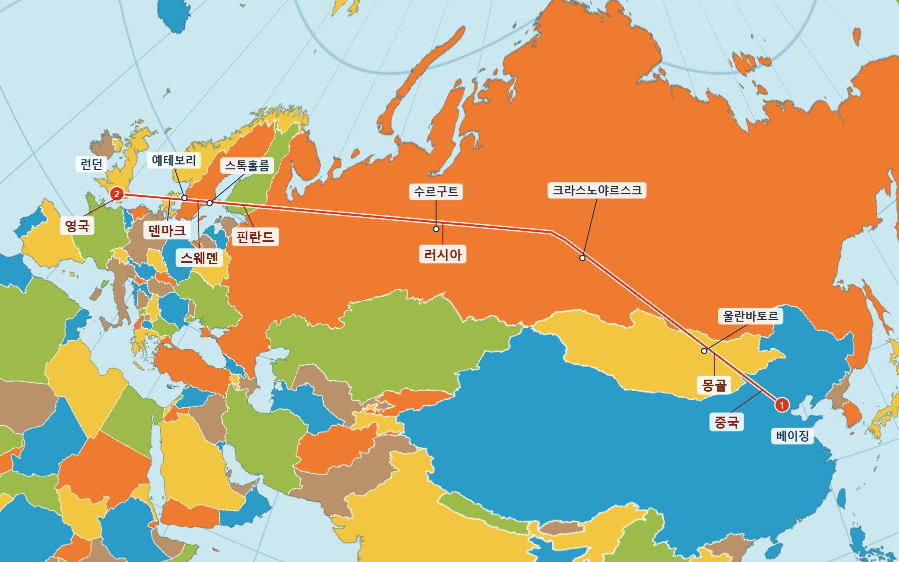

# tetra-unfold

[English](README.md) | [繁體中文](README.zh-TW.md) | [简体中文](README.zh-CN.md) | [日本語](README.ja.md) | **한국어** | [Deutsch](README.de.md) | [Français](README.fr.md) | [Español](README.es.md) | [Русский](README.ru.md)

> 이 문서는 영어판의 번역입니다. 내용이 다를 경우 [영어판](README.md)이 우선합니다.

**베이징에서 런던으로 날아가면 어떤 나라와 도시를 지날까요?**



<sub>그림은 두 지점 사이의 최단 대권 경로이며, 실제 항공편의 비행 경로가 아닙니다.</sub>

중국 → 몽골 → 러시아 → 핀란드 → 스웨덴 → 덴마크 → 영국 순서이며, 전체 8,154 km입니다. 울란바토르, 크라스노야르스크, 수르구트, 스톡홀름, 예테보리 부근을 지납니다. 선이 꺾이는 곳은 지도의 접는 선이며 비행기가 방향을 트는 것이 아닙니다. [이 경로 열기](https://iantpe.github.io/tetra-unfold/?lang=ko&trip=PEK,LHR&rt=0).

**출장 일정을 짜거나, 환승 경로를 비교하거나, 비행기가 어디를 지나는지 알고 싶을 때 쓸 수 있는 세계 지도입니다.** 먼저 지도에서 경로가 효율적인지 확인한 뒤 항공권 가격을 비교하세요. [지도를 열면](https://iantpe.github.io/tetra-unfold/?lang=ko) 바로 쓸 수 있고 설치할 것은 없습니다.

예를 들어 타이베이에서 런던까지는 직항 9,783 km, [상하이 경유](https://iantpe.github.io/tetra-unfold/?lang=ko&trip=TPE,PVG,LHR&rt=0) 9,918 km(135 km 증가에 그침), [도하 경유](https://iantpe.github.io/tetra-unfold/?lang=ko&trip=TPE,DOH,LHR&rt=0) 12,160 km(2,377 km 증가)입니다.

이 지도는 구 전체를 **정사면체**에 펼친 뒤, 평면을 **이음매 없이 채울 수 있는** 직사각형으로 만든 것입니다.

이 프로젝트는 세계 지도를 예로 들며, 나루카와 하지메의 [AuthaGraph 세계 지도](https://www.authagraph.com/)에서 영감을 받았지만 그 구현은 아닙니다. AuthaGraph의 정확한 알고리즘은 특허가 있고 공개되지 않았기 때문에, 여기서는 직접 유도한 근사 방법을 사용합니다. 같은 방법을 **360° 카메라 이미지**에도 적용할 수 있어, AI 모델이 구 전체를 한 장의 평면 이미지로 볼 수 있습니다.


## 데모

**온라인에서 사용해 보기: <https://iantpe.github.io/tetra-unfold/?lang=ko>**

지도는 繁體中文, 简体中文, English, 日本語, 한국어, Deutsch, Français, Español, Русский의 9개 언어를 지원합니다. 브라우저 언어에 맞춰 자동으로 선택되며, 패널의 메뉴로 바꾸거나 주소에 `?lang=`(`zh-Hant`, `zh-Hans`, `en`, `ja`, `ko`, `de`, `fr`, `es`, `ru`)를 붙여 지정할 수 있습니다.

여정, 거리 범위, 지도 회전 각도와 각종 설정은 작업하는 대로 주소에 저장됩니다. 북마크하거나 다른 사람에게 보내면 똑같은 화면으로 열립니다. 패널의 **공유 링크 복사**로 주소를 복사할 수 있습니다. 예를 들어 [이 링크](https://iantpe.github.io/tetra-unfold/?lang=ko&trip=TPE,NRT,LHR,SIN&range=TPE,5000)를 열면 타이베이 → 도쿄 → 런던 → 싱가포르 여정과 타이베이 중심 반경 5,000 km 범위가 나타납니다. 서버에는 아무것도 저장되지 않으며, 모든 정보는 주소 안에 있습니다.

지도는 HTML 파일 하나와 `i18n.js`(화면 문구), `tetra-map.js`(투영과 그리기), `trip-order.js`(가장 짧은 순서 계산), `airports.json`, `names/<언어>.json`(공항 이름과 도시 이름)으로 이루어져 있습니다. 설치나 빌드는 필요 없습니다(D3와 국경 데이터를 불러오려면 인터넷 연결이 필요합니다).

| 파일 | 내용 |
|---|---|
| [`index.html`](index.html) · [열기](https://iantpe.github.io/tetra-unfold/?lang=ko) | 사면체 세계 지도. 사면체의 한 모서리가 동경 90°를 따라 지도의 세로 중심선이 되고, 양 끝 꼭짓점은 위쪽 변과 아래쪽 변의 가운데에 있습니다. 기본 상태에서는 북극이 위쪽 꼭짓점에 있으며, 위아래로 드래그하면 지구가 이 모서리를 따라 움직여 남극이 아래쪽 꼭짓점에 올 때까지 이동합니다('북극을 위로', '남극을 아래로' 버튼으로 바로 전환할 수 있습니다). 드래그는 이 두 위치에서 멈추며, 체크박스를 해제하면 제한 없이 돌릴 수 있습니다. 두 위치 모두 다른 모서리 꼭짓점은 바다 위에 있습니다. 이음매 없는 타일링, 드래그로 지구 회전, 면적 보정 켜기/끄기, 사면체 접는 선 표시, 나라 위에 마우스를 올리면 국가 이름 표시를 지원합니다. |

조작 방법:

- 드래그: 지구 돌리기(`index.html`에서는 Shift + 드래그로 화면 이동)
- 마우스 휠: 확대/축소(`index.html`)
- 마우스 올리기: 국가 이름과 위도·경도 표시
- 휴대전화(`index.html`): 한 손가락으로 드래그하면 지구가 돌아가고, 두 손가락으로 확대/축소와 이동을 합니다. 탭하면 이름이 표시됩니다. 공항을 추가하려면 공항을 탭한 뒤 **여정에 추가**를 누릅니다. 설정과 여정은 화면 아래쪽 막대에 있으며, 탭하거나 위로 밀면 열립니다

### 여러 도시를 도는 출장 경로 계획하기(`index.html`)

이 지도는 비행 방향을 확인하는 데 편리합니다. 면적 보정을 끄면(기본값) 삼각형 각 면이 심사 도법이 되어, 대권 항로는 같은 면 안에서는 직선이고 접는 선을 지날 때만 꺾입니다.

- 지도 위 공항 점을 클릭하거나, IATA 코드, 도시, 공항 이름, 국가를 선택한 언어 또는 영어로 입력하면 일정에 추가됩니다(예: `TPE`, `London`, `런던`, `Londres`). 한 도시에 공항이 여러 개 있으면 이용객이 가장 많은 공항이 먼저 나옵니다. 확대하면 중형 공항도 표시됩니다.
- 각 구간은 대권 항로로 그려지고, 구간별 거리와 총거리가 표시됩니다. **마지막에 출발지로 돌아오기**를 선택하면 왕복으로 계산합니다.
- **가장 효율적인 순서 계산**은 첫 번째 지점을 출발지로 고정하고 나머지 지점을 총거리가 가장 짧은 순서로 배열합니다. 한 여정은 최대 30곳입니다. 16곳까지는 실제로 가장 짧은 순서를 구하고, 그보다 많으면 근사 계산이라 가장 짧다고 보장할 수 없습니다.
- 경로 일부가 보이지 않으면 북쪽을 위로 유지한 채 경로가 가장 모이는 방향으로 지도가 자동으로 돌아갑니다. 지점을 추가하거나 순서를 계산한 뒤, 또는 각도가 저장되지 않은 링크를 열 때 작동합니다. **경로를 가운데로**를 누르면 언제든 직접 가운데로 옮길 수 있습니다. 지구를 한 바퀴 도는 여정은 끊김을 피할 수 없어 출발지가 지도 양쪽에 나타납니다.
- 거리는 반지름 6,371 km인 구에서 계산한 대권 거리입니다. 실제 항로는 보통 조금 더 깁니다.

#### AI 브라우저 도우미로 항공권 비교하기

이 지도는 거리가 가장 짧은 순서를 찾아 주지만, 어떤 경로가 가장 싸거나 빠른지는 알려 주지 않습니다. 그 부분은 브라우저를 다룰 수 있는 AI 도우미(Claude in Chrome, ChatGPT 에이전트 등)에게 맡길 수 있습니다. 도우미가 지도에서 순서를 읽고, Google 항공편 같은 검색 사이트에서 구간별로 찾아본 뒤, 조합을 비교표로 정리해 줍니다. 예를 들어 이렇게 요청합니다.

> https://iantpe.github.io/tetra-unfold/ 를 열고, 타이베이(TPE)에서 출발해 도쿄, 싱가포르, 런던을 거쳐 타이베이로 돌아오는 일정을 짜 줘. 지도가 찾은 순서와 다른 순서를 비교해 줘. 그다음 Google 항공편에서 12월 1, 4, 7, 10일 이코노미 편도를 검색해서, 순서별 항공권 합계와 이동 시간 합계를 정리해 줘.

이 일정으로 실제 테스트한 결과(2026년 11월에 표시된 가격, 성인 1명, 이코노미, 세금 포함 편도, 단위는 대만 달러):

| 방문 순서(마지막에 타이베이로) | 대권 거리 | 찾은 항공편 | 항공권 합계 | 이동 시간 합계 |
|---|---:|---|---:|---:|
| 도쿄 → 싱가포르 → 런던 | 28,206 km | 런던 구간은 상하이 경유 | NT$49,198 | 47시간 30분 |
| 도쿄 → 싱가포르 → 런던 | 28,206 km | 런던 구간은 도하 경유 | NT$50,509 | 44시간 5분 |
| 도쿄 → 런던 → 싱가포르(지도의 순서) | 25,878 km | 상하이, 뮌헨 경유 | NT$50,779 | 45시간 50분 |

- **가장 짧은 순서가 항상 가장 싼 것은 아닙니다.** 지도의 순서는 2,328 km(8.3%)를 줄였지만, 이 날짜에는 항공권이 조금 더 비쌌습니다. 운임은 주로 그 노선을 어떤 항공사가 운항하는지에 따라 정해집니다.
- **경유지가 순서만큼 중요할 수 있습니다.** 싱가포르–런던 구간을 상하이 경유에서 도하 경유로 바꾸자 1,311 대만 달러가 더 들었지만 3시간 25분이 줄었습니다.
- **야간 비행은 현지 체류 시간을 줄입니다.** 이것은 지도에서 보이지 않습니다.

그러니 먼저 지도로 되돌아가는 순서를 걸러 내고, 남은 몇 가지 순서의 항공권을 AI 도우미에게 비교하게 하세요. 도우미에게는 검색만 맡기고, 예약과 결제는 직접 하세요. 운임은 계속 바뀌며, 다구간 항공권이 편도를 따로 사는 것보다 쌀 때도 있으니 그것도 함께 확인해 달라고 하면 좋습니다.

### 거리 범위 (`index.html`)

중심(공항 코드, 도시, 또는 여정의 첫 공항)과 반경(km 또는 비행 시간)을 정하면, 대권 거리가 그 범위 안에 있는 곳이 색칠되고, 원 안에서 대형 공항이 있는 도시가 가까운 순서로 표시됩니다. 지도 위 어디에나 마우스를 올리면 중심에서의 거리가 나옵니다.

지구에서는 범위가 원이지만, 이 지도에서는 정원이 아닙니다. 한 면 안에서는 매끄러운 타원이고, 접는 선을 지날 때 꺾입니다. 예를 들어 타이베이를 중심으로 한 반경 5,000 km 원에는 델리(4,373 km)와 다윈(4,298 km)이 들어가고, 뭄바이(5,002 km)는 아슬아슬하게 밖에 있습니다. 비행 시간은 평균 시속 800 km로 환산한 대략적인 값입니다.

### 비행 재생(`launch.html`)

[`launch.html`](launch.html) · [온라인 버전](https://iantpe.github.io/tetra-unfold/launch.html)은 Starship 11차 시험 비행을 사면체 지도에서 재생하고, 시간, 고도, 속도, 고도 그래프, 일반 지도 위의 같은 경로를 보여 줍니다. 중앙 모서리가 화면 가운데에 수직으로 고정되어 남북을 쉽게 알 수 있습니다. **이것은 설명을 위해 재구성한 것이며 실측 원격 측정 자료가 아닙니다.** 발사장, 착수 지점, 공개된 일정, 지구 자전으로 재구성했습니다. 상승 구간과 재진입 구간의 고도와 속도는 가정한 값입니다. 이 페이지는 데이터 파일을 재생할 뿐 궤도를 계산하지 않습니다.

이 페이지는 **실측** 장거리 비행도 재생합니다. [2012년 9월 6~7일 NASA Global Hawk 비행](https://iantpe.github.io/tetra-unfold/launch.html?flight=global-hawk-hs3)으로, 캘리포니아주 Dryden에서 버지니아주 Wallops까지 허리케인 Leslie의 동쪽을 돌아 날았습니다(19.2시간, 11,576 km). [`flights/global-hawk-hs3.json`](flights/global-hawk-hs3.json)는 NASA 항법 파일에서 1분마다 한 행을 뽑은 것입니다. 기록이 없는 12분과 4분 구간은 직선으로 이었습니다. 이 파일에는 이 저장소의 라이선스가 아니라 NASA 데이터 조건이 적용됩니다. 인용: Sorenson, C. (2025). *Hurricane and Severe Storm Sentinel (HS3) Global Hawk Navigation* [Data set]. NASA GHRC DAAC. https://doi.org/10.5067/HS3/NAV/DATA201

**다른 비행을 보여 주려면** `flights/`에 데이터 파일을 추가하고([`flights/starship-11.json`](flights/starship-11.json)을 틀로 쓸 수 있습니다) `launch.html`의 `FLIGHTS`에 넣으세요. `rows`는 열마다 배열 하나입니다: `t`(발사 후 초), `lat`, `lon`(도), `alt`(km), `speed`(km/h), `dist`(지상 거리, km). 행 사이의 값은 페이지가 보간합니다. 제목, 라벨, 이벤트, 출처, 지도 방향도 같은 파일에 있습니다.

**새 경로에 맞게 지도 방향을 정하려면** 데이터 파일의 `view`만 바꾸면 됩니다. 확대 비율은 자동으로 계산됩니다.

1. 페이지를 열고 “Whole route”(전체 경로)를 누른 뒤, 경로가 보기 좋을 때까지 지도를 드래그하세요.
2. 브라우저 콘솔에 `[state.yaw, state.pitch]`를 입력하세요.
3. 두 숫자를 `view`의 `yaw`와 `pitch`에 넣으세요.

`yaw`는 중앙선의 경도에서 90을 뺀 값입니다(−180보다 작으면 360을 더합니다). `pitch`의 범위는 0~70.5이며, 경로가 남쪽에 있을수록 보통 더 큰 값이 필요합니다. 경로가 색깔 있는 꼭짓점에 너무 가까우면 날카로운 V자로 꺾입니다.

## Claude Code, Codex 또는 Antigravity에서 사용하기

이 저장소에는 코딩 에이전트가 쓸 수 있는 스킬 두 개가 들어 있습니다. 클론한 뒤 폴더 안에서 [Claude Code](https://code.claude.com/docs/en/skills) 또는 [Codex](https://learn.chatgpt.com/docs/build-skills)를 실행하거나 [Antigravity](https://antigravity.google/docs/skills)에서 폴더를 열고 평소 말하듯 요청하면 됩니다.

```
git clone https://github.com/ianTPE/tetra-unfold
cd tetra-unfold
claude    # 또는 codex
```

| 스킬 | 요청 예시 | 필요한 것 |
|---|---|---|
| `plan-route` | 타이베이에서 출발해 도쿄, 싱가포르, 런던을 도는 가장 짧은 여정을 짜고 지도 링크를 줘 | Node.js |
| `plan-route` | 이 여정의 실제 항공편과 총액을 Google Flights에서 찾아 줘. 12월 7일 출발, 도시마다 3일 체류 | Node.js, 에이전트가 조작할 수 있는 브라우저 |
| `unfold-360` | photo.jpg를 펼쳐 줘 | Python, `pip install numpy pillow` |

스킬은 이 저장소 안에서 에이전트를 사용할 때만 불러옵니다. 경로 도구는 에이전트 없이도 실행할 수 있습니다: `node plan_route.js TPE Tokyo Singapore London`. 계산 결과는 대권 거리이며 운임이나 항공편 유무는 포함하지 않습니다. 실제 항공편과 운임은 에이전트가 브라우저에서 Google Flights로 조회하며, 예약은 하지 않습니다.

## 원리

### 이음매 없이 이어지는 이유

평면을 한 변의 길이가 1인 정삼각형 격자로 덮습니다. 격자점 `(i, j)`를 `i`와 `j`의 홀짝으로 나누면 정확히 4종류가 되어 정사면체의 꼭짓점 4개에 하나씩 대응하고, 작은 삼각형 하나하나가 사면체의 면이 됩니다.

정사면체의 각 꼭짓점에는 면 3개가 만나므로 꼭짓점 둘레의 각도 합은 3 × 60° = **180°**입니다. 즉 평면 전체는 모든 격자점을 중심으로 180° 회전시켜 반복한 사면체 표면으로 볼 수 있습니다. 직사각형 `[0, 2] × [0, √3/2]`이 정확히 지도 한 장이며, 위아래로 이웃한 직사각형은 180° 회전되어 있어 어느 방향으로든 끝없이 이어 붙일 수 있습니다. `index.html`은 이 격자를 90° 돌려 한 모서리를 세로로 세웁니다. 지도는 `√3 × 1` 직사각형으로, 네 변의 중점에 꼭짓점이 하나씩 있고 내부에는 꼭짓점이 없으며, 이것도 정확히 지도 한 장입니다.

### 평면에서 구면으로

각 픽셀은 다음 순서로 계산합니다:

1. 픽셀이 들어 있는 작은 삼각형을 찾고 무게중심 좌표를 구합니다.
2. 무게중심 좌표로 사면체의 해당 면 위의 점을 정합니다.
3. 그 점을 구면으로 옮깁니다. 두 가지 모드가 있습니다:
   - **보정 없음(심사 도법)**: 구의 중심에서 바깥으로 곧게 투영합니다. 각 면은 초광각 핀홀 카메라로 찍은 이미지처럼 보이며, **직선은 직선으로 유지**됩니다.
   - **면적 보정**: 면 중심에서 나가는 각 반직선을 따라 거리를 다시 배분해, 지도 위 면적이 구면 위 면적에 대략 비례하도록 합니다.
4. 회전 행렬을 곱해 위도와 경도를 구하고, 정거 원통 도법 텍스처에서 색을 가져옵니다.

모든 픽셀을 역방향으로 찾기 때문에 다각형 클리핑이 필요 없고, 타일링과 회전도 거의 추가 작업 없이 됩니다.

### 모서리의 왜곡은 피할 수 없다

사면체 꼭짓점 둘레는 180°뿐이지만, 구 위의 모든 점 둘레는 360°입니다. 따라서 어떤 공식을 쓰더라도 꼭짓점 4개 근처는 약 2배로 늘어납니다. AuthaGraph에도 같은 왜곡이 있으며, 모서리를 바다 위에 둡니다.

## 응용: 360° 카메라, AI 인식, 드론 자세

360° 카메라는 보통 정거 원통 도법 이미지(2:1 파노라마)를 내보냅니다. 이는 여기서 쓰는 세계 지도 텍스처와 같은 형식이므로, 텍스처를 360° 사진으로 바꾸기만 하면 이 방법을 쓸 수 있습니다.

자주 쓰는 형식과 비교하면:

- **정거 원통 도법**: 좌우 가장자리에서 물체가 잘리고, 양극 부근이 크게 늘어납니다.
- **큐브맵(6면)**: 각 면은 일반 사진처럼 보이지만 이음매가 많고, 이음매에 걸친 물체는 따로 처리해야 합니다.
- **사면체 펼치기**: 직사각형 이미지 한 장이 끊김 없이 구 전체를 담아 일반 이미지 모델에 바로 넣을 수 있습니다. 단점은 모서리 4개 근처의 왜곡입니다.

### 지평선 배치

[`unfold360.py`](unfold360.py)는 `index.html`과 같은 `√3 × 1` 펼침(사면체의 한 모서리가 가운데를 세로로 지남)을 쓰며, 카메라가 수평일 때 다음과 같이 되도록 돌려 놓았습니다:

- **가로 중심선이 지평선입니다.** 이미지의 위쪽 절반은 모두 하늘, 아래쪽 절반은 모두 땅이며, 각각 정확히 구의 절반입니다.
- 이미지 가운데는 정면입니다. 정후방은 네 모서리에 있고, 지평선은 좌우 가장자리를 따라 이어집니다.
- 천정은 위쪽 변의 1/4과 3/4 지점에, 천저는 아래쪽 변의 같은 지점에 있습니다.
- 사면체의 모서리 4개는 위쪽 변과 아래쪽 변의 가운데(정면, 지평선 위아래 54.7°)와 좌우 변의 중점(지평선 위, 좌우 각각 125.3°)에 있습니다.

모서리의 왜곡은 피할 수 없으므로, **두 방향으로 각각 펼치고** 방향마다 모서리에서 더 먼 쪽 이미지를 쓸 수 있습니다. **B는 A를 수직축 중심으로 180° 돌린 것**입니다. A의 모서리 4개는 지평선 위아래로 대칭이므로, 돌리고 나면 B의 모서리는 A 모서리의 정반대편, 곧 A 각 면의 정중앙(A의 왜곡이 가장 작은 곳)에 옵니다. 두 이미지 모두 하늘이 위쪽입니다. 이렇게 하면 모든 방향이 두 이미지 중 하나에서는 모서리에서 35.3° 이상 떨어지며, 지평선 위의 모든 점도 마찬가지입니다:

| B를 돌리는 각도 | 가장 불리한 방향과 모서리의 거리 |
|---|---|
| 180° | 35.3° |
| 150° | 20.3° |
| 90° | 9.8° |
| 0° | 0°(두 이미지가 같음) |

```
pip install numpy pillow
python unfold360.py photo.jpg out/
```

### 드론 자세: 하늘과 땅 구분하기

드론은 IMU(자이로스코프와 가속도계)로 어느 쪽이 위인지 압니다. 하지만 가속도계가 재는 것은 **중력에 드론 자체의 가속도를 더한 값**이므로, 돌풍, 충돌, 뒤집힘, 급격한 기동 중에는 알려 주는 '아래' 방향이 틀리고, 자이로스코프만으로는 시간이 지나며 오차가 쌓입니다. 자기 센서도 전자기 간섭에 쉽게 영향을 받습니다.

360° 이미지에서 하늘과 땅의 경계는 **독립적인 기준**입니다. 전자기 간섭에도, 드론의 가속도에도 영향을 받지 않습니다. 아이디어는 **IMU와 결합하는 것**입니다. 평소에는 IMU를 쓰고, 외란을 받아 가속도계를 믿을 수 없을 때 이미지에서 본 위쪽 방향으로 자세를 보정합니다. 간섭 속에서도 계속 비행해야 하는 드론에 특히 중요합니다.

지평선 배치는 이 용도에 잘 맞습니다:

- 이음매 없는 이미지 한 장이 구 전체를 덮으므로, 드론이 어떻게 돌아도 하늘이 이미지 가장자리에서 잘리지 않습니다.
- 드론이 수평일 때 위쪽 절반은 하늘, 아래쪽 절반은 땅이므로, 하늘/땅 분할 모델을 학습시키기 위한 레이블링이 간단합니다.
- 면적 보정 모드에서는 모든 픽셀이 같은 입체각을 차지하므로, 픽셀 방향을 그대로 평균할 수 있습니다.

#### 테스트

[`drone_attitude.py`](drone_attitude.py)는 사진마다 무작위 자세 300가지(완전히 뒤집힌 경우 포함)를 모의합니다. 각 자세에서 드론 자체의 좌표계로 360° 이미지를 펼치고(128 × 74 픽셀, 면적 보정), 일부러 단순하게 만든 규칙으로 '위'를 추정합니다:

- 밝고 푸른빛이 도는 픽셀을 하늘로 봅니다. 임계값은 이미지마다 자동으로 정합니다(오츠 방법).
- 새까만 '데이터 없음' 영역은 제외합니다.
- 위쪽 방향 = 하늘 픽셀의 평균 방향 − 땅 픽셀의 평균 방향.

Wikimedia Commons의 항공 360° 파노라마 6장(촬영 Gunther Tschuch, CC BY-SA 4.0)으로 실행했습니다:

| 지형 | 위아래 오판 | 오차(중앙값) | 오차(90%) | 최대 | 추정 시간(펼침 제외) |
|---|---|---|---|---|---|
| 농경지(Sebnitz) | 0 / 300 | 5.4° | 8.5° | 10.7° | 0.9 ms |
| 마을(Bad Karlshafen) | 0 / 300 | 6.6° | 10.7° | 13.9° | 0.9 ms |
| 강 계곡 마을(Hirschhorn) | 0 / 300 | 7.6° | 11.4° | 16.7° | 0.9 ms |
| 섬 해안(Skye) | 0 / 300 | 11.1° | 16.1° | 20.5° | 0.9 ms |
| 호수(Loch Tay) | 0 / 300 | 11.5° | 16.2° | 18.4° | 0.9 ms |
| 해안과 산지(Mull) | 0 / 300 | 13.6° | 18.1° | 22.3° | 0.9 ms |

| 수평 | 70° 기울임 | 추정 결과로 수평으로 되돌림 |
|---|---|---|
|  |  |  |

알게 된 점:

- **무작위 자세 1,800가지에서 하늘과 땅을 뒤바꾼 경우는 한 번도 없었습니다.** 방향 오차는 중앙값 5–14°, 최대 22°였습니다. 데스크톱 CPU에서 Python으로 추정 단계는 약 1 ms 걸렸고, 2048 × 1024 이미지를 펼치는 데 약 12 ms가 더 들어 프레임당 합계 약 13 ms입니다.
- 하늘을 비추는 수면(호수, 해안)에서 오차가 가장 큽니다.
- **카메라가 하늘을 볼 수 있어야 합니다.** 이 파노라마들은 고도각 약 25° 위가 새까맣습니다. 카메라가 드론 아래에 달려 있기 때문입니다. 검은 영역을 제외하기 전에는 대부분의 자세에서 위아래를 반대로 판단했습니다. 실제로 쓰려면 위쪽 반구도 찍을 수 있는 카메라, 예를 들어 기체 위아래에 렌즈가 있는 360° 카메라가 필요합니다.
- 지상(높이 1.5 m)에서 찍은 파노라마는 비행 중인 드론을 대표하지 못합니다. 나무와 건물이 하늘의 상당 부분을 가리기 때문입니다.

한계:

- 뒤집힘은 정지된 파노라마를 회전시켜 모의했습니다. 움직임에 의한 흐림, 급격한 노출 변화, 프로펠러가 화면에 들어오는 경우, 역광은 아직 테스트하지 않았습니다.
- 밝기 규칙은 밤, 눈 위, 구름 위에서는 통하지 않습니다. 학습된 하늘/땅 분할 모델이 필요하며, 그러면 5–14°의 오차도 줄어들 것입니다.
- 추정 결과를 IMU와 결합하는 부분은 아직 구현하지 않았습니다.

## 수치 검증

투영 코드는 Node.js로 다음을 확인했습니다:

- 평행 이동과 180° 회전 뒤의 타일링 오차는 약 10⁻¹⁵(가장자리가 정확히 일치)이며, 지도는 거울상이 아닙니다.
- 지도 좌표와 구면 좌표 사이의 왕복 오차는 두 모드 모두 10⁻¹² 미만입니다.
- 면적 왜곡(지도 위 면적 ÷ 실제 면적):

| 모드 | 범위 |
|---|---|
| 보정 없음 | 0.13 – 3.3배 |
| 면적 보정 | 0.55 – 1.4배 |

- 형태 왜곡(최대 늘어남과 최소 늘어남의 비)은 보정 없음 모드에서 모서리 10° 이내는 약 2.4배, 35° 밖에서는 1.5배 이하입니다.

## 관련 도법

지구를 사면체에 펼치는 생각 자체는 새롭지 않습니다. 가장 가까운 선행 사례:

- **[Lee 정각 사면체 도법](https://en.wikipedia.org/wiki/Lee_conformal_world_in_a_tetrahedron)**(L. P. Lee, 1965년). 마찬가지로 지구를 정사면체에 옮겨 평면을 채울 수 있으며, 그 단위는 같은 `√3 × 1` 직사각형으로 다시 배열할 수 있습니다. 원판은 남극을 중심으로 하며, 남극이 꼭짓점 위에 있습니다. 정각 도법(국소적인 형태가 정확함)이므로 대권은 곡선이 됩니다. D3에는 [`d3.geoTetrahedralLee`](https://unpkg.com/browse/d3-geo-polygon@1.9.0/README.md)로 구현되어 있으며, 보통 극을 중심에 둔 삼각형으로 그립니다.
- **[Doug McIlroy의 사면체 지도 카드](https://cs.dartmouth.edu/~doug/cards/page1983.pdf)**(1983년)는 Lee 도법을 사용해 두 극을 마주 보는 두 모서리의 중점에 두고, 꼭짓점 4개를 모두 바다 위에 두었습니다.
- **[AuthaGraph](https://en.wikipedia.org/wiki/AuthaGraph_projection)**(나루카와 하지메)는 직사각형으로 이음매 없이 이어지는 사면체 지도이며, 모서리를 바다 위에 둡니다. 알고리즘은 특허가 있고 공개되지 않았습니다.

이 프로젝트의 차이점:

- 한 모서리가 지도 가운데를 세로로 지나며, 드래그하면 지구가 그 모서리를 따라 움직여 북극이 위쪽 꼭짓점에 있는 상태와 남극이 아래쪽 꼭짓점에 있는 상태 사이를 오갑니다.
- 각 면이 심사 도법이므로, 대권 항로는 같은 면 안에서 직선입니다.
- 지도 위에 출장 계획 기능이 있습니다: 9개 언어의 공항 검색, 항로, 거리, 가장 짧은 방문 순서.

## 관련 여행 계획 도구

여러 구간의 항로를 그리고 대권 거리를 합산하는 웹 도구는 이 밖에도 있습니다:

| | 보이는 범위 | 항로 | 적합한 용도 |
|---|---|---|---|
| [Great Circle Map](https://www.greatcirclemap.com/) | 돌릴 수 있는 3D 지구(메르카토르 도법 지도도 선택 가능). 지구는 한 번에 절반만 보임 | 정확한 대권 호. 거리는 타원체로 계산 | 한 구간이나 몇 구간 |
| [RapidToolset Multi-City Flight Planner](https://rapidtoolset.com/en/tool/multi-city-flight-planner) | 세계 전체를 기존 평면 지도로 표시 | 지점 사이에 호를 그림. 고위도 항로가 늘어나 실제 방향을 판단하기 어려움 | 거리 합산 |
| 이 지도 | 세계 전체를 이음매 없이 이어지는 평면 한 장에 표시 | 각 면 안에서는 직선이고 접는 선에서만 꺾임 | 여러 나라를 도는 복잡한 일정의 **순서** 계획 |

지구본은 방향은 정확하지만 일정 전체를 한 번에 볼 수 없고, 기존 지도는 일정 전체를 볼 수 있어도 방향이 오해를 부릅니다. 이 지도는 일정 전체를 실제에 가까운 방향으로 한 번에 보여 주며, 가장 짧은 방문 순서를 찾을 수 있습니다.

여기서의 거리는 구(반지름 6,371 km)로 계산합니다. Great Circle Map 같은 타원체 거리와의 차이는 0.4% 미만입니다(예: 타이베이–런던: 9,783 km 대 9,802 km). 이는 방문 순서에 따른 차이보다 훨씬 작으므로, 어느 순서가 가장 짧은지는 바뀌지 않습니다.

## 출처

- [D3.js](https://d3js.org/) 7.9.0: 정거 원통 도법과 국경 그리기
- [TopoJSON](https://github.com/topojson/topojson) 3.0.2
- [world-atlas](https://github.com/topojson/world-atlas) 2.0.2: [Natural Earth](https://www.naturalearthdata.com/)(1:50m)에서 가져온 국경 데이터
- [OurAirports](https://ourairports.com/data/): 공항 목록(`airports.json`, 정기편이 있고 IATA 코드가 있는 공항), 퍼블릭 도메인
- [Wikidata](https://www.wikidata.org/): 중국어, 일본어, 한국어, 독일어, 프랑스어, 스페인어, 러시아어 공항 이름과 도시 이름, 검색 결과 정렬에 쓰는 이용객 수, CC0. 중국어 이름은 [OpenCC](https://github.com/BYVoid/OpenCC)로 번체(대만 용법) 또는 간체로 변환했습니다. 국가 이름은 브라우저 내장 번역(`Intl.DisplayNames`)을 사용합니다
- [Wikimedia Commons](https://commons.wikimedia.org/): 드론 테스트에 쓴 항공 360° 파노라마, 촬영 Gunther Tschuch(PaulT), CC BY-SA 4.0: [Sebnitz Ottendorf](https://commons.wikimedia.org/wiki/File:Sebnitz_Ottendorf_Aerial_Pan360.jpg), [Kassel Bad Karlshafen](https://commons.wikimedia.org/wiki/File:Kassel_Bad_Karlshafen_Aerial_Pan360.jpg), [Hirschhorn (Neckar)](https://commons.wikimedia.org/wiki/File:Hirschhorn_(Neckar)_Aerial_Pan360.jpg), [Skye Dun Beag](https://commons.wikimedia.org/wiki/File:Skye_Dun_Beag_Aerial_Pan360.jpg), [Perth and Kinross Loch Tay](https://commons.wikimedia.org/wiki/File:Perth_and_Kinross_Loch_Tay_Aerial_Pan360.jpg), [Mull Lochbuie](https://commons.wikimedia.org/wiki/File:Mull_Lochbuie_Aerial_Pan360.jpg). `examples/aerial_*.jpg`는 Sebnitz Ottendorf 파노라마를 변형한 것으로 CC BY-SA 4.0 라이선스입니다
- AuthaGraph는 나루카와 하지메의 작품이자 등록 상표입니다. 이 프로젝트와는 관련이 없습니다.

## 라이선스

[PolyForm Noncommercial 1.0.0](LICENSE). 개인 사용, 학습, 연구, 취미 프로젝트, 그리고 학교·자선 단체·공공 연구 기관·정부 기관의 사용은 무료입니다.

**상업적 사용에는 별도의 유료 라이선스가 필요합니다.** ertiach@gmail.com으로 연락해 주세요.

- 이 라이선스는 이 저장소의 코드에 적용됩니다. 위에 나열한 라이브러리와 데이터(D3, TopoJSON, world-atlas / Natural Earth, OurAirports, Wikidata)는 각자의 라이선스를 따릅니다. `examples/aerial_*.jpg`는 CC BY-SA 4.0입니다(출처 참고).
- 정식 조항은 영어로 된 LICENSE 파일이며, 이 설명은 참고용입니다. 영어 조항이 우선합니다.
