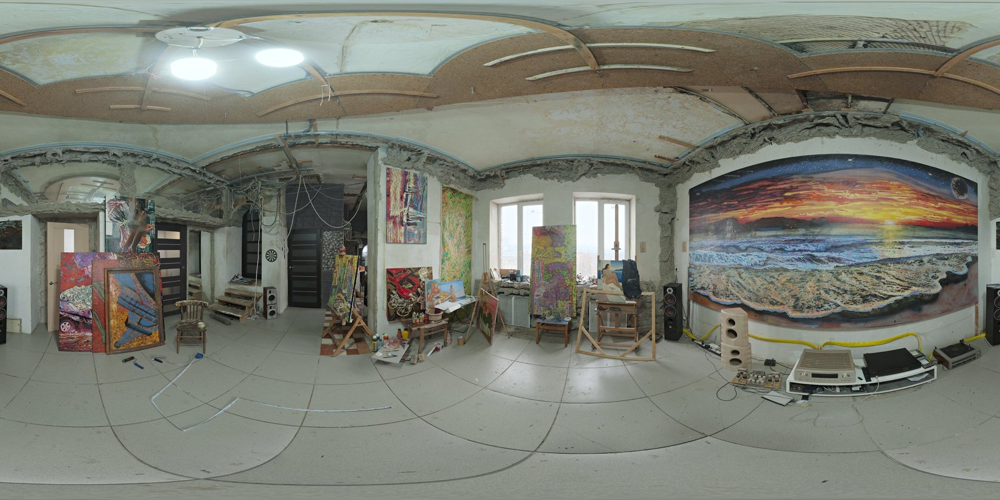
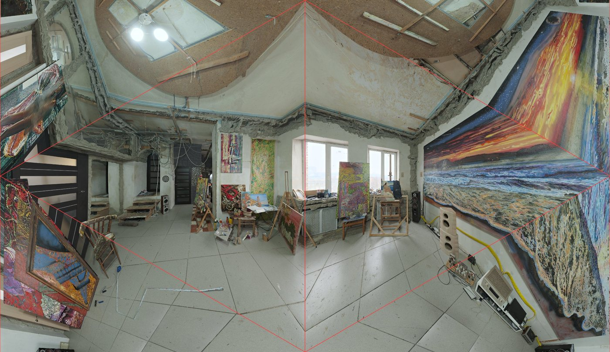
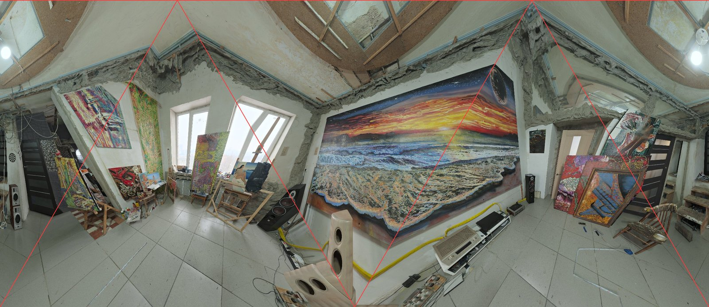

# tetra-unfold

**English** | [繁體中文](README.zh-TW.md)

Unfold the whole sphere onto a **regular tetrahedron**, then flatten it into a rectangle that **tiles the plane seamlessly**.

The demo uses a world map and is inspired by the [AuthaGraph world map](https://www.authagraph.com/) by Hajime Narukawa. It is not an implementation of AuthaGraph: that algorithm is patented and unpublished, so this project uses its own approximation. The same method can also be applied to **360° camera images**, so that an AI model can see the entire sphere in a single flat image.

## Demos

**Try it online:**

- World map: <https://iantpe.github.io/tetra-unfold/>
- Dual-orientation unfolding: <https://iantpe.github.io/tetra-unfold/dual.html>

Both pages are single HTML files. There is nothing to install or build: open one in a browser. An internet connection is needed to load D3 and the country data.

| File | What it shows |
|---|---|
| [`index.html`](index.html) · [live](https://iantpe.github.io/tetra-unfold/) | Tetrahedral world map. One tetrahedron edge runs down the vertical centre line along 90°E, with corners at the top and bottom centre. By default the North Pole is on the top corner; dragging up and down slides the globe along that edge until the South Pole is on the bottom corner (the **North Pole up** and **South Pole down** buttons jump between the two). Dragging stops at these two positions; a checkbox removes the limit so the globe can keep turning. The other corners stay in the oceans in both positions. Seamless tiling, drag to rotate the globe, optional area correction, tetrahedron fold lines, and country names on hover. |
| [`dual.html`](dual.html) · [live](https://iantpe.github.io/tetra-unfold/dual.html) | Dual-orientation unfolding. The same globe is unfolded in two orientations so that their corners do not overlap, with a map of which orientation to use for each place. |

Controls:

- Drag: rotate the globe (in `index.html`, Shift + drag pans the view)
- Mouse wheel: zoom (`index.html`)
- Hover: show the country name and coordinates

### Planning a multi-stop trip (`index.html`)

The map is handy for checking flight directions: with area correction off (the default), each triangular face is a gnomonic projection, so a great-circle route is a straight line within a face and only bends where it crosses a fold line.

- Add airports by clicking the dots on the map, or by typing an IATA code, a city, an airport name or a country, in Chinese or English (for example `TPE`, `倫敦`, `Munich`). When a city has several airports, the busiest one comes first. Zoom in to also see medium-sized airports.
- Each leg is drawn as a great-circle route, with its distance and the trip total. Tick **return to the start** for a round trip.
- **Find the smoothest order** keeps the first stop as the starting point and tries every order of the others (up to 10 stops), then picks the shortest total distance.
- Distances are great-circle distances on a sphere of radius 6,371 km. Real flight paths are usually somewhat longer.

## How it works

### Why it tiles seamlessly

The plane is covered by a lattice of equilateral triangles with side length 1. Grouping the lattice points `(i, j)` by the parity of `i` and `j` gives exactly 4 classes, one for each vertex of the tetrahedron, and every small triangle becomes one face of the tetrahedron.

Three faces meet at each vertex of a regular tetrahedron, so the total angle around a vertex is 3 × 60° = **180°**. This means the whole plane is the tetrahedron's surface repeated by 180° rotations about every lattice point. The rectangle `[0, 2] × [0, √3/2]` holds exactly one complete map. Neighbouring rows are rotated by 180°, so copies of the map tile infinitely in every direction. `index.html` turns this lattice by 90° so that one edge is vertical: its map is the `√3 × 1` rectangle with a corner at the midpoint of each side and none inside, which is also exactly one complete map.

### From the plane to the sphere

Each pixel is computed as follows:

1. Find the small triangle that contains the pixel and compute its barycentric coordinates.
2. Use the barycentric coordinates to pick a point on the matching face of the tetrahedron.
3. Push that point onto the sphere, in one of two modes:
   - **Uncorrected (gnomonic)**: project straight out from the centre of the sphere. Each face looks like an ultra-wide pinhole camera image, and **straight lines stay straight**.
   - **Area-corrected**: redistribute distances along each ray from the face centre so that areas on the map are roughly proportional to areas on the sphere.
4. Apply the rotation matrix to get longitude and latitude, then sample the colour from an equirectangular texture.

Because every pixel is looked up in reverse, there is no polygon clipping to deal with, and tiling and rotation come almost for free.

### Corner distortion is unavoidable

A tetrahedron vertex has only 180° around it, but every point on a sphere has 360°. The area near each of the 4 vertices must therefore be stretched by about 2×, whatever formula is used. AuthaGraph has the same distortion and places its corners in the oceans.

## Dual-orientation unfolding

Since corner distortion cannot be removed, unfold the sphere **twice, in two orientations**, so the corners of the two maps fall in different places:

- **Orientation A**: the 4 corners sit in the Pacific, the North Atlantic, the South Atlantic and the Indian Ocean.
- **Orientation B**: the globe is rotated a further 180° about its axis before unfolding.

The 4 corners of A are symmetric about the equator. After a 180° rotation, B's corners land exactly opposite A's corners, at the centre of each of A's faces, where A has the least distortion. North points the same way in both maps, so neither is upside down.

For each place, use whichever map puts it further from a corner. The table shows how far the worst place on Earth is from a corner, depending on how far B is rotated:

| B rotated by | Worst place, distance from a corner |
|---|---|
| 180° | 35.2° |
| 150° | 20.3° |
| 90° | 9.9° |
| 0° | 0° (both maps identical, no benefit) |

## Application: 360° cameras and AI recognition

360° cameras usually export equirectangular images (2:1 panoramas). That is the same format as the world map texture used here, so the method works by swapping the texture for a 360° photo.

Compared with common formats:

- **Equirectangular**: objects are cut at the left and right edges, and the poles are heavily stretched.
- **Cubemap (6 faces)**: each face looks like an ordinary photo, but there are many seams, and objects across seams need extra handling.
- **Tetrahedral unfolding**: one rectangular image with no cuts, which can be fed directly to standard image models. The drawback is distortion near the 4 corners.

Suggested pipeline:

1. Unfold the same 360° photo twice: in the original orientation and rotated 90° horizontally (for the upright orientation, see below).
2. Run the AI model on both images.
3. Convert each detected object back to sphere coordinates and keep the result from the image where it is further from a corner.

For AI recognition, the **uncorrected mode** may work better, because straight lines stay straight and the images are closest to the ordinary photos that models are trained on.

### Test with a real 360° photo

[`unfold360.py`](unfold360.py) unfolds an equirectangular photo onto the tetrahedron, using the same formulas as `index.html` (requires `pip install numpy pillow`):

```
python unfold360.py photo.jpg out/          # upright orientation (default)
python unfold360.py photo.jpg out/ --map    # world-map orientation
```

Unlike the Earth, a photo has a clear up and down. By default the script uses an **upright orientation**: the zenith sits on the top edge of the rectangle and the nadir on the bottom edge, so the ceiling is at the top, the floor at the bottom, and things on the walls stand roughly upright. The 4 corners fall at ±35° elevation (the two on the top edge are in the ceiling; the three on the bottom edge are in the floor, and the ones at the left and right ends are the same point), so every point on the horizon is at least 35° from a corner.

For dual-orientation unfolding, B must be rotated **90°** about the vertical axis in the upright orientation. A 180° rotation maps the tetrahedron onto itself, so both images would be identical. With 90°, the worst place in the panorama is 35.3° from a corner, the same as for the world map. Pass `--map` to use the same world-map orientation as orientation A of `dual.html`.

Tested with the [Art Studio](https://polyhaven.com/a/art_studio) panorama from Poly Haven (red lines are the tetrahedron fold lines):

| Original equirectangular image |
|---|
|  |

| Orientation A | Orientation B (rotated 90°) |
|---|---|
|  |  |

What we observed:

- The whole room fits in one image with no cuts. The speakers split across the left and right edges of the equirectangular image are joined here.
- The ceiling is at the top and the floor at the bottom; doors, windows, easels and speakers stand roughly upright, which is easier to read than a tilted orientation.
- Each triangular face is a separate perspective view, so straight lines such as wall corners and ceiling edges bend where they cross a fold line.
- Objects near a corner are enlarged and stretched, for example the beige speaker at the bottom centre of orientation B.
- In orientation A the large mural is crossed by a fold line and visibly bent; orientation B places it in the middle, almost intact. This confirms the idea of using whichever image puts an object further from a corner.
- Left and right match the original photo; the image is not mirrored.

> So far this is a first test with one photo, judged by eye. It has **not yet been run through an AI object detector**, and the step that converts detections back to sphere coordinates and picks the better result is not implemented.

## Numerical checks

The projection code has been checked with Node.js:

- Tiling error after translation and 180° rotation is about 10⁻¹⁵ (the edges match exactly), and the map is not mirrored.
- Round-trip error between map coordinates and sphere coordinates is below 10⁻¹² in both modes.
- Area distortion (map area ÷ true area):

| Mode | Range |
|---|---|
| Uncorrected | 0.13× – 3.3× |
| Area-corrected | 0.55× – 1.4× |

- Shape distortion (ratio of maximum to minimum stretch) in uncorrected mode: about 2.4× within 10° of a corner, and 1.5× or less beyond 35°.

## Related projections

Unfolding the globe onto a tetrahedron is not new. The closest earlier work:

- **[Lee's conformal tetrahedral projection](https://en.wikipedia.org/wiki/Lee_conformal_world_in_a_tetrahedron)** (L. P. Lee, 1965). It also maps the globe onto a regular tetrahedron and tiles the plane, and its tile can be rearranged into the same `√3 × 1` rectangle. The original is centred on the South Pole, which sits on a vertex. It is conformal (local shapes are right), so great circles are curved. It is available in D3 as [`d3.geoTetrahedralLee`](https://unpkg.com/browse/d3-geo-polygon@1.9.0/README.md), usually drawn as a triangle with the pole at its centre.
- **[Doug McIlroy's tetrahedral map card](https://cs.dartmouth.edu/~doug/cards/page1983.pdf)** (1983) uses Lee's projection with the poles at the midpoints of two opposite edges and all four vertices in the oceans. This is the same arrangement as the upright orientation `unfold360.py` uses for photos.
- **[AuthaGraph](https://en.wikipedia.org/wiki/AuthaGraph_projection)** (Hajime Narukawa) is a rectangular, seamlessly tiling tetrahedral map with its corners in the oceans. Its algorithm is patented and unpublished.

What this project does differently:

- One edge runs vertically down the centre of the map, and dragging slides the globe along it between the North Pole on the top corner and the South Pole on the bottom corner.
- Each face is a gnomonic projection, so great-circle flight routes are straight within a face.
- It includes a trip planner on top of the map: airport search in Chinese and English, routes, distances and the shortest visiting order.

## Credits

- [D3.js](https://d3js.org/) 7.9.0: equirectangular projection and border rendering
- [TopoJSON](https://github.com/topojson/topojson) 3.0.2
- [world-atlas](https://github.com/topojson/world-atlas) 2.0.2: country boundaries derived from [Natural Earth](https://www.naturalearthdata.com/) (1:50m)
- [OurAirports](https://ourairports.com/data/): airport list (`airports.json`, airports with scheduled service and an IATA code), public domain
- [Wikidata](https://www.wikidata.org/): Chinese airport and city names, and passenger counts used for ranking search results, CC0. Simplified names were converted to Taiwan usage with [OpenCC](https://github.com/BYVoid/OpenCC)
- [Poly Haven](https://polyhaven.com/a/art_studio): test 360° photo "Art Studio" by Oliksiy Yakovlyev, CC0
- AuthaGraph is the work and registered trademark of Hajime Narukawa. This project is not affiliated with it.

## License

[PolyForm Noncommercial 1.0.0](LICENSE). Personal use, study, research, hobby projects, and use by schools, charities, public research and government organisations are free.

**Commercial use needs a separate paid license.** Contact ertiach@gmail.com.

- The license covers the code in this repository. The libraries and data listed above (D3, TopoJSON, world-atlas / Natural Earth, OurAirports, Wikidata, the Poly Haven photo) keep their own licenses.
