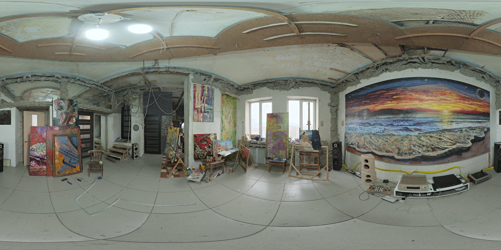
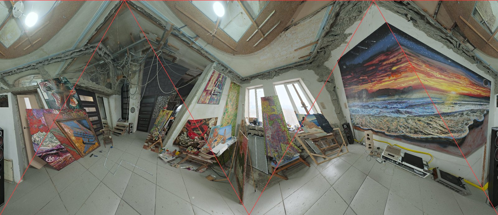
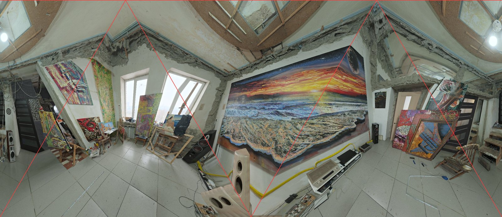

# tetra-unfold

[English](README.md) | **繁體中文**

把整個球面展開到**正四面體**上，再攤平成一張可以**無縫拼接**的長方形平面圖。

這個專案以世界地圖為例，受 [AuthaGraph 世界地圖](https://www.authagraph.com/)（鳴川肇設計）啟發，但不是它的實作：AuthaGraph 的精確演算法有專利且未公開，這裡用的是自己推導的近似做法。同樣的方法也可以用在 **360 相機影像**上，讓 AI 在一張平面圖裡辨識整個球面的內容。

## 展示頁面

**線上展示：**

- 世界地圖：<https://iantpe.github.io/tetra-unfold/>
- 雙方向展開：<https://iantpe.github.io/tetra-unfold/dual.html>

兩個頁面都是單一 HTML 檔，不需要安裝或建置，用瀏覽器直接開啟就能使用（需要網路連線來載入 D3 和國界資料）。

| 檔案 | 內容 |
|---|---|
| [`index.html`](index.html) · [線上開啟](https://iantpe.github.io/tetra-unfold/) | 四面體世界地圖。四面體的一條邊沿著 90°E 直立在圖的垂直中線上，兩端頂點在上邊中央和下邊中央。預設北極在上方頂點；上下拖曳時地球沿著這條邊移動，直到南極落在下方頂點（「北極在上」「南極在下」兩個按鈕可以直接切換）。拖曳會停在這兩個位置；取消勾選「上下拖曳限制在北極、南極之間」就可以繼續轉。兩種位置下，其他角落頂點都在海上。可以無縫拼接、拖曳轉動地球、切換面積校正、顯示四面體摺線，滑鼠移到國家上會顯示國名。 |
| [`dual.html`](dual.html) · [線上開啟](https://iantpe.github.io/tetra-unfold/dual.html) | 雙方向展開。同一顆地球用兩種方向各展開一次，讓兩張圖的「角落」錯開，並標示每個地方該看哪一張。 |

操作方式：

- 拖曳：轉動地球（`index.html` 按住 Shift 拖曳可以平移畫面）
- 滾輪：縮放（`index.html`）
- 滑鼠移過地圖：顯示國名與經緯度

### 排出差行程（`index.html`）

這張地圖很適合看飛行方向：面積校正關閉時（預設），每個三角形面都是心射投影，大圓航線在同一面內是直線，只有跨過摺線時才會轉折。

- 在地圖上點機場的小圓點，或輸入機場代碼、城市、機場名稱或國家（中英文都可以，例如 `TPE`、`倫敦`、`Munich`），就能加入行程。一個城市有好幾個機場時，旅客最多的排在前面。放大後也會顯示中型機場。
- 每一段都畫成大圓航線，並列出每段距離和總距離。勾選「最後回到出發地」就算來回。
- 「算最順的順序」會固定第一站當出發地，把其他各站的所有排法都試一遍（最多 10 站），挑出總距離最短的走法。
- 距離是以地球半徑 6,371 公里算的大圓距離，實際航線通常會長一些。

## 原理

### 為什麼可以無縫拼接

平面用邊長 1 的正三角形格子鋪滿。把格點座標 `(i, j)` 依奇偶分成 4 類，正好對應正四面體的 4 個頂點，每個小三角形就是四面體的一個面。

正四面體每個頂點有 3 個面相接，繞頂點一圈是 3 × 60° = **180°**，所以整個平面可以看成「繞每個格點轉 180°」後重複的四面體表面。長方形 `[0, 2] × [0, √3/2]` 剛好是一整張地圖，上下相鄰的長方形會轉 180°，因此可以往任何方向無限拼接。`index.html` 把格子轉 90°，讓一條邊直立：地圖是 `√3 × 1` 的長方形，四個邊的中點各有一個頂點、內部沒有頂點，同樣剛好是一整張地圖。

### 從平面到球面

每個像素依序這樣計算：

1. 找出這個像素落在哪個小三角形，算出它的重心座標（barycentric coordinates）
2. 用重心座標在四面體的對應面上取一點
3. 把這個點推到球面上，有兩種模式：
   - **不校正（心射投影）**：直接從球心往外投射。每一面就像一台超廣角針孔相機拍到的畫面，**直線保持直線**。
   - **面積校正**：沿著從面中心出發的每條射線重新分配距離，讓球面面積和平面面積大致成比例。
4. 套用旋轉矩陣得到經緯度，再到一張等距圓柱投影的貼圖上取顏色

因為整個流程是「逐像素反查」，所以不需要處理多邊形裁切，拼接與旋轉也都很容易做到。

### 角落的變形無法避免

四面體的頂點周圍只有 180°，球面上任何一點周圍卻是 360°，所以頂點附近一定會被撐開約 2 倍。無論投影公式怎麼設計都會這樣，AuthaGraph 原版也一樣，只是把角落放在海洋上。

## 雙方向展開

既然角落的變形避不開，就改用**兩個方向各展開一次**，讓兩張圖的角落落在不同地方：

- **方向 A**：四個角落放在太平洋、北大西洋、南大西洋、印度洋
- **方向 B**：把地球繞地軸多轉 180° 再展開

因為 A 的四個角落對赤道對稱，轉 180° 後，B 的角落剛好落在 A 角落的正對面，也就是 A 每一面的正中央（A 變形最小的地方）。兩張圖的北方方向相同，都不會上下顛倒。

每個地點取兩張中離角落比較遠的那張：

| B 錯開的角度 | 全球最差的地點離角落 |
|---|---|
| 180° | 35.2° |
| 150° | 20.3° |
| 90° | 9.9° |
| 0° | 0°（兩張一樣，沒有效果） |

## 應用：360 相機與 AI 辨識

360 相機匯出的照片通常是等距圓柱投影（2:1 的全景圖），和這裡用的世界地圖貼圖格式相同，所以只要把貼圖換成 360 照片就能套用。

和常見格式相比：

- **等距圓柱圖**：左右邊界會切斷物體，上下兩極被嚴重拉寬
- **Cubemap（立方體 6 面）**：每一面都像普通照片，但接縫很多，跨接縫的物體要另外處理
- **四面體展開**：一張長方形圖、沒有斷口，可以直接餵給一般的影像模型；缺點是四個角落會變形

建議的流程：

1. 同一張 360 照片輸出兩張展開圖：原本的方向，以及水平轉 90° 的方向（直立方向要轉 90°，見下方說明）
2. AI 分別辨識兩張
3. 每個偵測到的物體換算回球面座標，保留離角落比較遠的那張的結果

做 AI 辨識時，**不校正模式**可能比較合適，因為直線保持直線，最接近模型訓練時看過的一般照片。

### 實測：一張 360 照片

[`unfold360.py`](unfold360.py) 把等距圓柱照片展開成四面體平面圖，展開公式和 `index.html` 相同（需要 `pip install numpy pillow`）：

```
python unfold360.py photo.jpg out/          # 直立方向（預設）
python unfold360.py photo.jpg out/ --map    # 世界地圖方向
```

照片和地球不同，有明確的「上下」。腳本預設用**直立方向**：天頂放在長方形的上邊、天底放在下邊，所以天花板在上、地板在下，牆上的東西大致直立。四個角落落在仰角 ±35°（上邊的兩個角在天花板；下邊的三個角在地板，其中左右兩端是同一個點），水平視線一圈離角落至少 35°。

雙方向展開時，直立方向的 B 要水平轉 **90°**：直立方向繞垂直軸轉 180° 會和四面體自己重合，兩張圖會一模一樣。轉 90° 時，全景裡最差的地方離角落 35.3°，和世界地圖版相同。加 `--map` 可以改用和 `dual.html` 方向 A 相同的世界地圖方向。

用 Poly Haven 的 [Art Studio](https://polyhaven.com/a/art_studio) 全景照片測試（紅線是四面體摺線）：

| 原始等距圓柱圖 |
|---|
|  |

| 方向 A | 方向 B（轉 90°） |
|---|---|
|  |  |

觀察到的結果：

- 整個房間都在同一張圖裡，沒有切口；等距圓柱圖左右邊緣被切開的音響在這裡連在一起
- 天花板在上、地板在下，門、窗、畫架、音響都接近直立，比斜放的方向容易看懂
- 每個三角形面各自是一張透視圖，所以牆角、天花板邊這類直線碰到摺線會折一下
- 靠近角落的東西會被放大拉長，例如方向 B 下方中間的米色音響
- 方向 A 的大幅壁畫被摺線切過、有明顯彎折；方向 B 把它放在中間，幾乎完整，驗證了「哪張離角落遠就用哪張」的做法
- 左右方向和原始照片一致，沒有鏡像

> 目前只用一張照片做過初步測試，判斷是用肉眼看，**還沒有接上 AI 物件辨識模型**，也還沒有實作「換算回球面座標、挑選較好結果」的步驟。

## 數值驗證

以 Node.js 對投影程式做過以下檢查：

- 平移與 180° 旋轉後的拼接誤差約 10⁻¹⁵（完全接合），而且地圖不會左右鏡像
- 地圖座標與球面座標互換的來回誤差小於 10⁻¹²（兩種模式都是）
- 面積失真（地圖面積 ÷ 實際面積）：

| 模式 | 範圍 |
|---|---|
| 不校正 | 0.13 ～ 3.3 倍 |
| 面積校正 | 0.55 ～ 1.4 倍 |

- 形狀變形（最大與最小拉伸的比值），不校正模式下：離角落 10° 內約 2.4 倍，35° 以外約 1.5 倍以下

## 使用的資源

- [D3.js](https://d3js.org/) 7.9.0：等距圓柱投影與繪製國界
- [TopoJSON](https://github.com/topojson/topojson) 3.0.2
- [world-atlas](https://github.com/topojson/world-atlas) 2.0.2：國界資料，源自 [Natural Earth](https://www.naturalearthdata.com/)（1:50m）
- [OurAirports](https://ourairports.com/data/)：機場清單（`airports.json`，有定期航班且有 IATA 代碼的機場），公有領域
- [Wikidata](https://www.wikidata.org/)：機場和城市的中文名稱，以及用來排序搜尋結果的旅客人數，CC0 授權。簡體名稱以 [OpenCC](https://github.com/BYVoid/OpenCC) 轉成台灣用語
- [Poly Haven](https://polyhaven.com/a/art_studio)：測試用 360 照片「Art Studio」，作者 Oliksiy Yakovlyev，CC0 授權
- AuthaGraph 為鳴川肇（Hajime Narukawa）的作品與註冊商標，本專案與其無關

## 授權條款

採用 [PolyForm Noncommercial 1.0.0](LICENSE)。個人使用、學習、研究、業餘專案，以及學校、慈善團體、公共研究機構和政府單位使用，都免費。

**商業使用需要另外付費取得授權**，請聯絡 ertiach@gmail.com。

- 這個授權適用於本 repo 的程式碼。上面列出的函式庫與資料（D3、TopoJSON、world-atlas / Natural Earth、OurAirports、Wikidata、Poly Haven 照片）仍依各自的授權條款。
- LICENSE 檔是英文正式條文，中文說明僅供參考，以英文條文為準。
